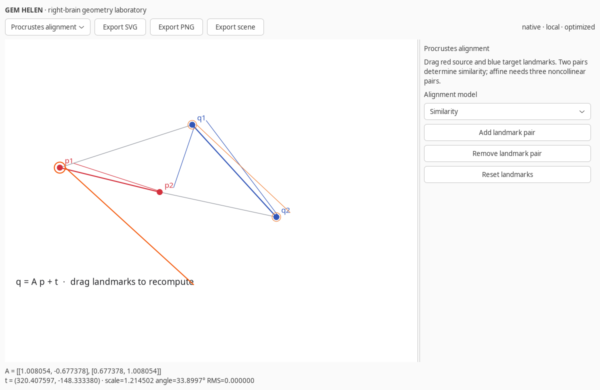
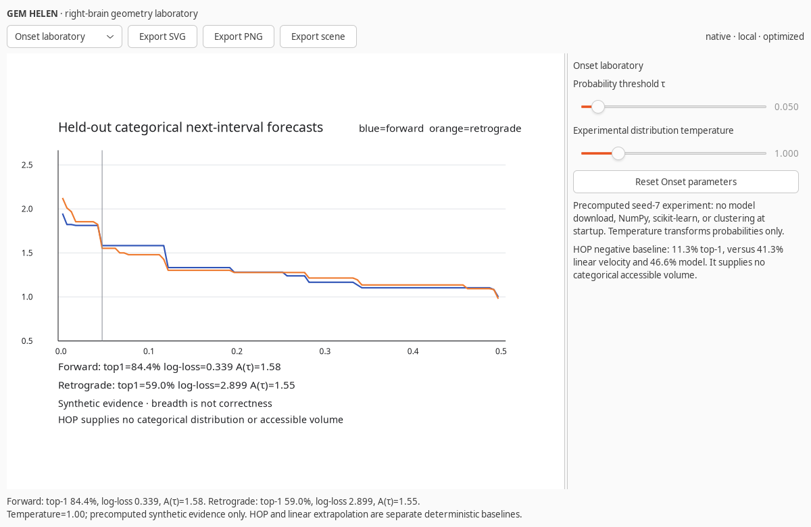

# GEM HELEN

GEM HELEN is a separate native repository for creative geometry, rhythm, and forecast-breadth experiments. It is the right-brain counterpart to investigation-focused GEM workbenches: local, compact, inspectable, and optimized for interactive use rather than reverse-engineering or forensic case management.

## Launch

```bash
python -m helen_gem
```

From a source checkout with the package on `PYTHONPATH`:

```bash
PYTHONPATH=. python -m helen_gem --module procrustes
```

After installation, the equivalent command is `gem-helen`.

Headless exports do not require GTK:

```bash
gem-helen --module procrustes --output landmarks.svg
gem-helen --module onset --output onset.json
gem-helen --module volume --output volume.png
```

Existing output files are not overwritten by the CLI.

## Optimization

- Standard-library mathematics, scene construction, accessible volume, SVG export, and compressed experiment loading.
- A 12 KB seed-7 rhythm artifact replaces model downloads and startup clustering.
- Lazy experiment loading only when the Onset module is selected.
- Bounded scenes, landmarks, ellipse/rule counts, and display vocabularies.
- GTK/Cairo imported only for native rendering or PNG output.
- No server, browser, background agent, model runtime, or automatic action.

## Native views





## Measured startup

On the development machine, core import took about 3.5 ms and the first lazy Onset load took about 11.7 ms. NumPy and scikit-learn were not imported. The wheel was also installed in isolation and its packaged Onset asset passed an export check. These measurements are environment-specific, not universal benchmarks. See [architecture and tradeoffs](docs/ARCHITECTURE.md).

## Modules

- Procrustes alignment with draggable landmarks and similarity, rigid, and affine modes.
- Ellipse fields and a ruled parabolic envelope.
- Circle, arc, sector, modular clock, and conditional graph invariants.
- Accessible volume with strict `p > τ`, complements, momentum, and experimental recommendations.
- Onset forecasts with held-out forward/retrograde correctness, log-loss, and threshold sweeps.

Every module exports the current scene as SVG, JSON, or PNG when Cairo is available.

## Onset evidence

The packaged artifact contains 1,920 held-out predictions for each condition from eight synthetic motifs, with 60 training and 20 test variations per motif. Forward top-1 is 84.375%; retrograde top-1 is 58.958%. Log-loss is 0.338856 and 2.898662, and sweep areas are 0.647474 and 0.649180. Accessible volume measures breadth, not correctness. HOP and deterministic extrapolation are separate baselines and supply no accessible-volume measurement.

The evidence is synthetic. It is not a result from real MIDI performances or a model of human surprise.

## Verification

The repository uses inline mathematical, artifact, CLI, and native X11 checks during development. The native interface is exercised with real GTK rendering, pointer dragging, module switching, bridge observation, and image export.
