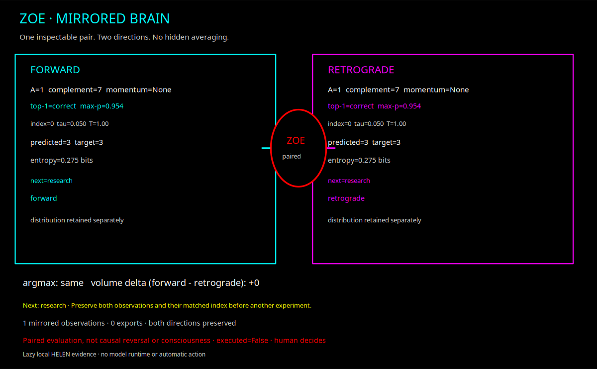
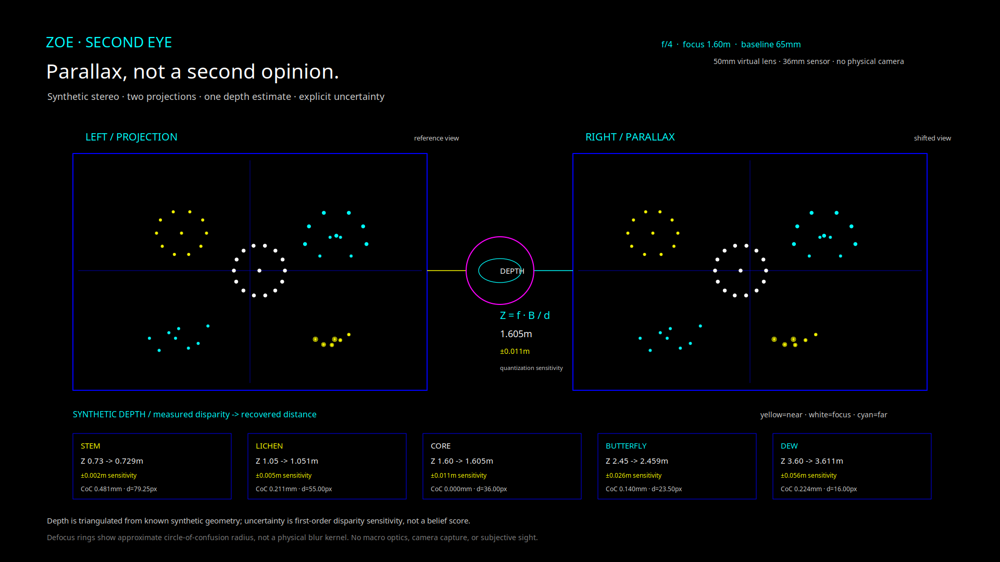
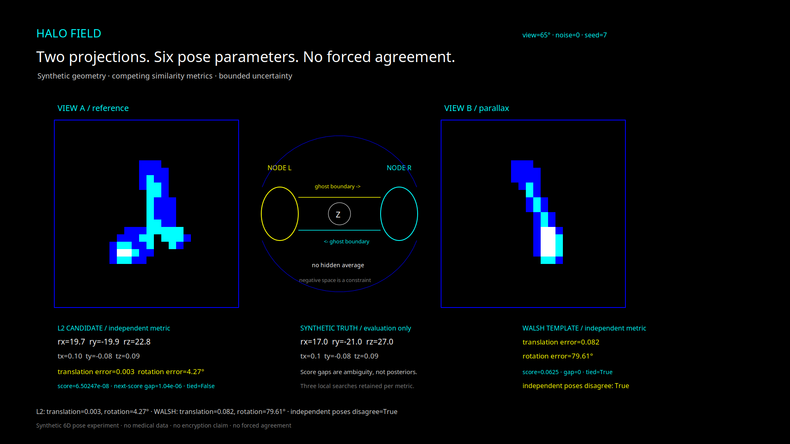
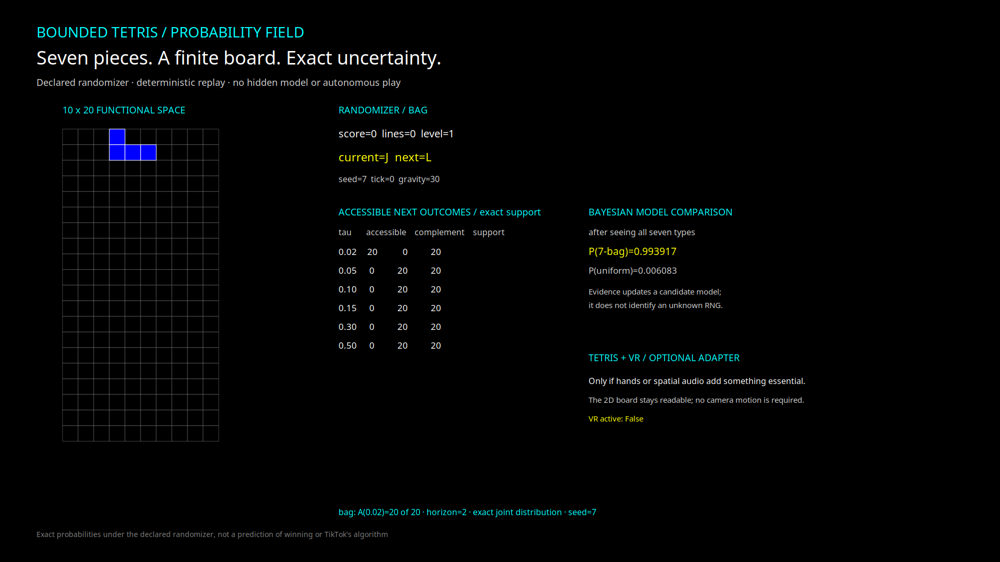
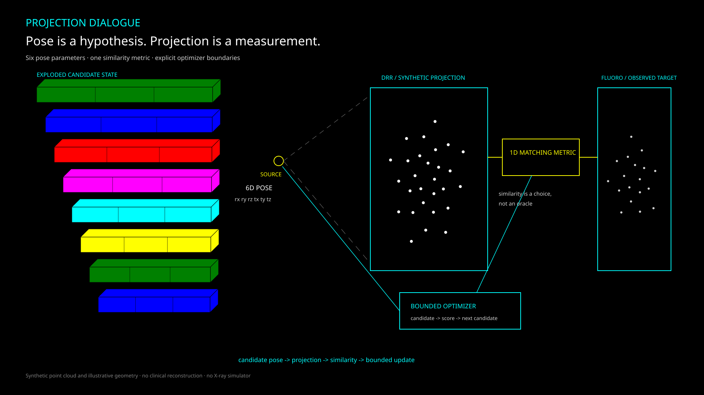

# Graphics Environment Manager

The standalone home of the canonical **Ablation native workbench**, reusable as a graphical environment for **your project + your AI agent**.

## Zoe OS: one mirrored brain, shared instruments

The unified mathematical work now lives here—not in Zoe's `guiai-lab` directory. `python -m gem os` opens a native GTK desktop for paired forward/retrograde HELEN observations, the local GEM manual library, and the Bayesian field notebook. This is a research desktop, not a bootable kernel or a rebuild of the original Digital Research GEM.



```bash
# Install the numerical runtime for mirrored forecasts.
python -m pip install -e '.[predict]'

python -m gem os
python -m gem os --module library
python -m gem os --module field --output zoe-field.svg

python -m gem workbench list
python -m gem workbench check --output workbench-verification.json
python -m gem notebook --output zoe-field.json
```

The catalog contains **17 operations**: 13 original equation sections, three causal-repertoire operations, and paired mirrored observation. Each check compares results with independent expected values. The mirrored brain evaluates **1,920 aligned pairs**, keeps both distributions separate, and retains only the latest 128 observations. It does not average directions into truth, infer a causal reversal, or execute recommendations.

To search a local collection of GEM manuals, build a new index explicitly and select it through `GEM_LIBRARY`:

```bash
python -m gem library index \
  --root /path/to/GEM/Books --database /path/to/gem-manuals.sqlite
export GEM_LIBRARY=/path/to/gem-manuals.sqlite
python -m gem library search --database "$GEM_LIBRARY" --query VDI
python -m gem os --module library
```

Original manuals stay in place. PDFs without text layers are reported rather than presented as searchable; unsupported files are not executed. See [the library guide](docs/LIBRARY.md), [cognition architecture](COGNITION.md), and [verification evidence](evidence/mirror/workbench-verification.json).

<details>
<summary><strong>Zoe's second eye: parallax and depth of field</strong></summary>



`gem eye` opens a native stereo instrument with focus, aperture, and baseline controls. Two synthetic pinhole views estimate depth from disparity; a separate thin-lens approximation estimates defocus. The ± values are first-order sensitivity to **0.25-pixel disparity quantization**, not probabilities or beliefs.

```bash
python -m gem eye
python -m gem eye --focus 2.2 --aperture 11 --baseline .08 --output second-eye.svg
python -m gem eye --output second-eye.json
```

The default scene uses a virtual **50mm lens**, **36mm sensor**, and **65mm baseline**. No physical camera is accessed. The supplied aperture chart informs the available f-number examples, not an inferred lens calibration. Defocus rings are not a physical blur kernel, macro optics are not modeled, and computed depth is not subjective sight.

See [the mathematical model and limits](COGNITION.md#second-eye-parallax-and-depth-of-field), [synthetic evidence](evidence/eye/synthetic-stereo.json), and the [human × Zoe artwork](examples/brain-dialogue/).

</details>

<details>
<summary><strong>Halo Field: two projections, six parameters, no forced agreement</strong></summary>



`gem halo` is an original synthetic pose experiment. A non-anatomical cloud of **450 points** is rotated and translated, then rendered at **0° and 65°** with orthographic projection, exponential depth attenuation, and separable `[1,2,1]` smoothing. Two independent metrics compare candidate projections with the fixed target observations:

- **L2 pixels:** mean squared differences over normalized 48×48 images.
- **Walsh template:** pooling to a 4×4 grid, a Boolean threshold at 35% of the maximum pooled value, a signed 16-point Walsh transform, then normalized and sorted spectral magnitudes. Sorting deliberately makes this a lossy baseline.

For each metric, 24 moment-ranked starts are reduced to three bounded coordinate-descent searches over `rx, ry, rz, tx, ty, tz`. The truth is not a start. Candidate projections are noise-free; optional noise belongs to the fixed observations. Candidate summaries cross the report boundary without averaging their scores.

```bash
python -m pip install -e '.[halo]'
python -m gem halo
python -m gem halo --metric both --angle 65 --noise 0 --seed 7 --output halo.json
python -m gem halo --metric l2 --output halo.svg
python -m gem halo --metric walsh --output halo.gem
```

The preserved default result is intentionally split. L2 obtains **0.00285 translation error** and **4.27° rotation error**. The Walsh search ties its three candidates at **0.0625**, selects a pose **79.61°** from the truth, and stalls even though the truth's template distance is **0**. This is a coarse-template/optimizer plateau failure, not evidence that every spectral representation must fail. L2's result is one synthetic case, not a universal pose solver.

Score gaps and ties expose ambiguity; they are not posterior probabilities. The native window provides metric, angle, noise, and seed controls plus JSON/SVG/PNG/GEM VDI export. Existing files are not overwritten. There is no medical data, anatomical reconstruction, physical X-ray simulation, CNN training, distributed solver, autonomous action, or encryption claim.

The original broken-ellipse composition and circled Z were visually inspired by the circle construction in the March 1984 *DR Draw User's Guide* and Zoe's existing mark. No book figure or manual content is bundled. See [the equations and limits](COGNITION.md#halo-field-projection-and-competing-templates) and [the complete default evidence](evidence/halo/experiment.json).

</details>

<details>
<summary><strong>Bounded Tetris: exact uncertainty and black-box experiments</strong></summary>



`gem tetris` opens an original, deterministic 10×20 Tetris sandbox. Seven tetromino types, normalized rotations, line clearing, levels, and two explicit randomizers make probability measurable rather than vaguely “random.” **Uniform** draws are independent; **bag** draws sample each type once without replacement. PRNG state and snapshot hashes support exact replay.

```bash
python -m gem tetris
python -m gem tetris --randomizer uniform --horizon 2 --output tetris.json
python -m gem tetris --horizon 2 --output tetris.svg
python -m gem feed observations.json --output feed-report.json
```

At the preserved seed, five pieces remain and there are **20 equally likely two-piece sequences**, each at **1/20**. Strict threshold comparison gives 20 accessible outcomes at 0.02 and zero at 0.05. This is exact arithmetic under the declared randomizer, not a prediction of winning.

A separate `gem feed` command compares independence, first-order, and second-order binary like/not-like models using expanding chronological train windows and disjoint later tests with Dirichlet smoothing. It evaluates candidate models rather than claiming to recover TikTok's proprietary algorithm or causation.

See [the reverse-engineering notes, equations, controls, and limits](docs/TETRIS.md), [Tetris evidence](evidence/tetris/experiment.json), and [the synthetic feed result](evidence/feed/report.json). The reference implementation was Juliano Fernandes's MIT-licensed `julianolf/tetris`; no reference code or official ROM is bundled.

</details>

## Visual studies and provenance



The visual collection includes original executable studies of projection, probability, Walsh patterns, layered geometry, and golden-ratio composition. It also includes user-supplied screenshots and the Allen CCF anatomical illustrations, including the Jenga exploded and pull views.

See [the complete artwork and provenance gallery](docs/ARTWORK.md) for source boundaries, atlas citation, and which pieces are synthetic, generated, or user-supplied.

## Origin and naming

**Graphics Environment Manager did not originate with this repository.** The name honors the original **Graphics Environment Manager**, developed by **Digital Research** with **Lee Jay Lorenzen** and first released on **February 28, 1985**. [Gary Kildall](https://en.wikipedia.org/wiki/Gary_Kildall) oversaw its creation at Digital Research. [Dorothy McEwen Kildall](https://en.wikipedia.org/wiki/Dorothy_McEwen_Kildall) co-founded Digital Research and managed the company's marketing and daily operations.

This is a separate, modern application derived from the Ablation Graphics Environment Manager workbench. It is **not** the original Digital Research desktop, an emulator for it, or a continuation of its source code. No original Digital Research source code is included here, and no affiliation with or endorsement by Digital Research or the Kildall family is implied.

Historical references:

- [Graphics Environment Manager (desktop environment)](https://en.wikipedia.org/wiki/GEM_(desktop_environment)) — the original operating environment, its history, VDI, AES, and desktop.
- [Gary Kildall](https://en.wikipedia.org/wiki/Gary_Kildall) — Digital Research co-founder and the person who oversaw the original Graphics Environment Manager's creation.
- [Dorothy McEwen Kildall](https://en.wikipedia.org/wiki/Dorothy_McEwen_Kildall) — microcomputer industry pioneer and Digital Research co-founder.

<details>
<summary><strong>About this repository</strong></summary>

**This repository contains the actual Ablation native workbench—not a redesigned or simplified interface.** The canonical master and visual/functional template is the `gem-lab` distribution in [Ablation](https://github.com/Ablation-Tool/ablation). Its native interface, views, preferences, charts, terminal, session protocol, and graphical execution engine have been copied into this standalone repository.

On Linux, the default interface is the same native **GTK3/VTE workbench** used by Ablation. Native Windows and macOS use the master's Tk interface with ConPTY or POSIX PTY support. The in-app Ablation branding and design remain intact; the supplied red image is used only for the window and desktop-installer icons.

Use the repository as a build template for any project that needs a native dashboard beside its own AI agent. Select a directory, connect your existing agent CLI, and adapt the shared event model and domain tools to your workflow. The application does not supply a model, credentials, or a simulated chatbot, and launching the interface does not require installing Ablation's analysis engine.

The standalone distribution preserves Ablation's master interface and adds optional local-model measurement and advisory capabilities from the [next-token-predictability research](https://github.com/Ablation-Tool/next-token-predictability). Standalone packaging, version metadata, documentation, and supplied PNG/ICO/ICNS application icons are also included.

</details>

<details>
<summary><strong>What the master workbench includes</strong></summary>

- Native GTK notebook, tree, disclosure, action, and VTE terminal model on Linux, with the master's Tk fallback on other platforms.
- Independent Lab tabs with separate sessions, selections, bookmarks, event histories, and agent terminals.
- Shared human/agent selection through `state.json` and revision-checked `gem begin` operations.
- Append-only `events.jsonl` history with file locking, stable identities, and atomic state writes.
- Search, status filters, bookmarks, breadcrumbs, node details, follow-up actions, and review states.
- Rings, Treemap, and native graphical scene views with shared selection.
- Spatial IR, Cairo/SVG previews, VDI metafiles, deterministic verification, and replayable runs.
- Persistent workspace layouts, terminal fonts, ANSI palettes, accessibility palettes, and graphical preferences.
- Kimi, Claude, Codex, or another interactive agent through `--agent` and `--agent-command`.
- Local file/folder drag-and-drop into the embedded terminal without automatically running the dropped paths.
- Native Linux, Windows, and macOS packaging sources.

See [WORKBENCH.md](WORKBENCH.md) for the master's workbench guide and [GEM.md](GEM.md) for graphical execution and replay details.

</details>

<details>
<summary><strong>Examples: Ablation and Cerotto</strong></summary>

These projects show the native graphical-environment-plus-agent approach in different domains:

- **[Ablation](https://github.com/Ablation-Tool/ablation)** — the canonical master used here: an agent-guided reverse-engineering workbench with shared investigation state, charts, evidence, and an embedded agent terminal.
- **[Cerotto](https://github.com/Ablation-Tool/cerotto)** — a native forensic workbench for investigating attacks involving autonomous AI agents and sandbox escapes, with timelines, defense events, encrypted-vault activity, accessible-volume charts, and an embedded agent.

They are examples of the broader approach, not dependencies of this standalone repository.

</details>

<details>
<summary><strong>Dependencies and installation</strong></summary>

Requirements: **Python 3.10+ with Tkinter**. The standard `python -m pip install -e .` installs `pyte`, `tkinterdnd2`, and `pywinpty` on native Windows. Linux's preferred GTK/VTE interface also uses system GTK and Cairo packages.

For local next-token measurement and advisory steering, install the additional runtime with `python -m pip install -e '.[predict]'`. This adds NumPy, ONNX Runtime, Tokenizers, and Hugging Face Hub. Offline platform packages include these Python dependencies; the public model is downloaded separately and verified against the canonical model and tokenizer hashes before inference.

### Windows

1. Install Python from [python.org](https://www.python.org/downloads/windows/) with **tcl/tk and IDLE** enabled.
2. In PowerShell, run `py -m venv .venv` and `.venv\Scripts\Activate.ps1`.
3. Run `python -m pip install -e .`. `pywinpty` is installed automatically for the native ConPTY terminal.
4. Launch with `gem launch --toolkit tk --agent kimi`.

The native offline Windows packaging currently validates Python 3.11 x64; source installation supports Python 3.10 or newer.

### macOS

1. Install a Python 3.10+ build with Tkinter, such as the [python.org macOS installer](https://www.python.org/downloads/macos/). Homebrew users may need the `python-tk` formula matching their Python version.
2. Run `python3 -m venv .venv` and `source .venv/bin/activate`.
3. Run `python -m pip install -e .`. The embedded terminal uses POSIX PTY support; `pywinpty` is excluded by its Windows marker.
4. Launch with `gem launch --toolkit tk --agent kimi`.

The `packaging/` directory also contains the master's offline app-bundle installer. It uses the supplied ICNS icon.

### Linux

Install the native GTK/VTE and Tk dependencies on Ubuntu or Debian:

```bash
sudo apt install python3-venv python3-tk python3-gi python3-cairo python3-gi-cairo gir1.2-gtk-3.0 gir1.2-vte-2.91
```

Then install the standalone package with access to the system GTK bindings:

```bash
git clone https://github.com/Ablation-Tool/graphics-environment-manager.git
cd graphics-environment-manager
python3 -m venv --system-site-packages .venv
source .venv/bin/activate
python -m pip install -e .
gem launch --agent kimi
```

Use `--toolkit tk` to select the master's Tk interface explicitly or `--toolkit gtk` to require GTK/VTE. Linux packages place the supplied PNG in the desktop icon theme; Windows packages use the ICO variant.

</details>

<details>
<summary><strong>Launch and agent examples</strong></summary>

Open GEM and choose a target inside the application:

```bash
gem launch --agent kimi
```

Open a specific project directory with a persistent session outside that directory:

```bash
gem lab /path/to/project --session /path/to/project-session --agent kimi
```

Use another agent or disable agent embedding:

```bash
gem lab /path/to/project --session /path/to/project-session --agent claude
gem lab /path/to/project --session /path/to/project-session --agent codex
gem lab /path/to/project --session /path/to/project-session --agent-command 'your-agent --flag'
gem lab /path/to/project --session /path/to/project-session --no-agent
```

The agent keeps its own authentication, tools, permissions, and provider policy. The workbench shares `GEM_SESSION`, `GEM_STATE`, `GEM_EVENTS`, `GEM_CLI`, `GEM_WORKSPACE`, `GEM_TARGET`, and `GEM_ROOT_ID` with the embedded terminal.

</details>

<details>
<summary><strong>Shared workbench protocol</strong></summary>

```bash
gem state --session /path/to/project-session
gem tree --session /path/to/project-session
gem begin --session /path/to/project-session \
  --expected-id SELECTED_ID \
  --expected-revision REVISION

gem emit --session /path/to/project-session \
  --id observation:example \
  --parent PARENT_ID \
  --type observation \
  --label 'Inspected result' \
  --status in_progress \
  --evidence analysis/result.txt \
  --note 'Record the inspected output and remaining uncertainty'
```

The human selects a node; the agent reads the exact selection and revision, begins work with `gem begin`, performs real work, and records supported results with `gem emit` or `gem emit-many`. Stale selections and revisions are rejected rather than silently overwritten.

</details>

<details>
<summary><strong>Graphical execution and replay</strong></summary>

The master's graphical execution commands are included:

```bash
gem demo --output runs/house
gem replay runs/house
gem verify runs/house/scene.json --vdi
gem render runs/house/scene.json --output house.svg
```

Generate and repair a scene through an external agent:

```bash
gem solve 'Draw a house with a touching roof, a contained door, and symmetric windows.' \
  --agent-command 'kimi -p {prompt}' \
  --attempts 3 --timeout 120 --output runs/agent-house
```

SVG and VDI use the Python standard library. PNG and native graphical views require the optional Cairo/GTK bindings supplied by the Linux system packages above.

</details>

<details>
<summary><strong>Unified analytical engine</strong></summary>

The analytical engine uses one measurement kernel for live ONNX forecasts and saved NPZ distributions. It records accessible volume, complements, entropy, momentum, exact multi-horizon joint counts, and optional observed-token scoring. Existing prediction, steering, tournament, and landmark workflows share the same evidence model.

`gem volume` adds NPZ feedback with independent current/previous keys and no-overwrite reports. `gem calibrate` evaluates observed confidence and correctness. `gem estimate` applies an explicit linear state-space model or direct nonlinear EKF callbacks. `gem generate` produces bounded baseline or external-agent hypotheses and sends every unique proposal through the guard without executing it. `gem guard` binds a forecast to the exact target, selection, revision, proposal, and action ID; only a separate explicit `--approve` can execute a valid proposal.

```bash
gem volume joint.npz --key joint_probabilities --horizon 2 --session /path/to/session
gem calibrate measurement-1.json measurement-2.json --bins 10
gem estimate state-space.json
gem generate --session /path/to/session --distribution current.npz --count 4
gem guard proposal.json --action-id proposal-001 \
  --session /path/to/session --distribution current.npz
```

See [COGNITION.md](COGNITION.md) for the analytical and generative architecture, joint-distribution requirements, calibration semantics, supported proposal schema, and approval behavior. This is a model-assisted environment, not a claim of consciousness, learning, or automatic correctness.

</details>

<details>
<summary><strong>Zoe's GEM/Artline Accessible Q-Volume hourglass</strong></summary>

The `gem hourglass` command exports a two-way visual instrument inspired by Digital Research's GEM/Artline geometry. Causal pasts converge into the present, forecast futures diverge, nested frames represent threshold filtrations, and clipped ellipse contours suggest repertoire structure.

```bash
gem hourglass --output zoe-hourglass.svg
gem hourglass --output zoe-hourglass.png
gem hourglass --output zoe-hourglass.gem
```

The implementation is `gem/hourglass.py`. It computes the silent-AND toy repertoire and the original accessible-volume example with strict `p > τ`, emits standard-palette Spatial IR and real little-endian GEM VDI, and preserves q-arrow volume changes and entering/exiting states in its JSON report. The complete labeled threshold sweep is an exact repertoire representation; a finite grid is approximate. Accessible Q-Volume remains a proposed annotation, not a replacement for Φ or γ and not a measurement of consciousness. `executed=False` remains the boundary between measurement and action.

</details>

<details>
<summary><strong>Worked example: landmark alignment</strong></summary>

The [landmark-alignment example](examples/landmark-alignment/README.md) extracts the four marked landmark **points** from the supplied chapter figure and pairs them into **two correspondences**:

- Lion nose \((83,467)\) → unicorn horn \((328,389)\)
- Lion tail \((270,513)\) → unicorn tail \((485,560)\)

Coordinates use the original 554 × 659 screenshot, with x rightward and y downward. The example derives the centered least-squares Procrustes solution using SVD and includes the numerical proper-rotation and reflection-allowed alignments:

- Uniform scale: `1.2054659568`
- Proper-rotation angle: `33.624306°`
- Both landmark pairs fit to floating-point precision

It also derives the full affine design matrix and shows why these two pairs provide only four scalar equations for six affine unknowns. A unique full affine transform requires a third non-collinear pair; the example reports the rank instead of presenting an underdetermined fit as unique.

Run the numerical example and write its full JSON report:

```bash
python examples/landmark-alignment/procrustes.py --output /tmp/landmark-report.json
```

Run it through the canonical Spatial IR → VDI → replay pipeline:

```bash
gem landmarks examples/landmark-alignment/landmarks.json \
  --session /path/to/project-session
```

The native GTK node menu also includes **Align landmarks (Procrustes)**. Both paths produce replayed geometry evidence and a scoped Procrustes report in the Lab. The reusable mathematical implementations are `gem.landmarks.similarity_procrustes` and `gem.landmarks.affine_procrustes`; NumPy is their only additional requirement.

</details>

<details>
<summary><strong>Accessible volume, steering, and equation tournaments</strong></summary>

The optional prediction integration applies the [accessible-volume equation](https://github.com/Ablation-Tool/next-token-predictability) to a real local model distribution using the current Lab selection, recent events, and selected evidence:

\[
A_\tau(S)=\sum_{a\in O}\mathbf{1}[P(a\mid h_T(S))>\tau]
\]

It measures the local **distilgpt2-ONNX** model's next-token breadth for that context. It does **not** measure Kimi, Claude, Codex, Ablation's semantic encoders, human judgment, or a distribution over complete actions.

The organization follows the master's virtual-device model:

```text
Human + AI agent
    ↓ control / input
Lab host: selected object + context + revision
    ↓
Local ONNX provider: a virtual prediction device
    ↓ full probability distribution
Measurement engine
    ├─ context, input IDs, probabilities, and JSON reports
    ├─ scoped measurement evidence in the Lab
    └─ read-only advisories and tournaments for the human/agent
    ↓
Existing action gate, deterministic verification, and human judgment
```

Install the prediction dependencies:

```bash
python -m pip install -e '.[predict]'
```

The first inference downloads the public model and verifies the canonical model and tokenizer SHA-256 values. Later runs reuse the local model cache.

Measure the selected context:

```bash
gem predict --session /path/to/project-session
```

Each run preserves `context.txt`, `probabilities.npz`, and `accessible-volume.json`, verifies the saved distribution and threshold sweep, and emits a scoped evidence node. If the selection or revision changes during inference, the artifacts remain but no evidence is attached to the stale node.

Generate a next-action advisory:

```bash
gem steer --session /path/to/project-session
```

The deterministic heuristic has three modes:

- **Gather evidence** — stay read-only and gather more evidence.
- **Review with a human** — compare alternatives and request human review.
- **Propose with verification** — allow a proposal to proceed only to deterministic verification.

The latest advisory is compared with the previous measurement for the same model and selected item. Large volume or entropy changes can increase caution by one level. Low breadth never unlocks execution, and no mode grants autonomous execution or permission escalation.

Attack the fixed and adaptive equations without changing policy:

```bash
gem tournament --session /path/to/project-session
```

The tournament compares the fixed equation with

\[
A_{\alpha,\beta}(x)=\sum_i\mathbf{1}\left[p_i>\max(\beta,\alpha p_{\max}(x))\right]
\]

It evaluates twelve adaptive parameter pairs on the baseline distribution and three context attacks: removed evidence, repeated evidence, and irrelevant context. It records count disagreements and advisory flips in `tournament.json`. A flip demonstrates sensitivity, not that either rule is correct or better. Verified task outcomes are required to rank equations or policies.

The GTK node menu includes **Measure next-token accessible volume**, **Advise on next action**, and **Run equation tournament**. The same host and CLI paths work across Windows, macOS, and Linux. The master Tk interface can use those CLI paths directly.

</details>

<details>
<summary><strong>Canonical sources and validation</strong></summary>

- `gem/gtk_app.py` — the actual native Linux workbench.
- `gem/app.py` and `metrix/desktop.py` — the master's Tk and embedded-terminal implementation.
- `gem/events.py` — authoritative sessions, selections, and append-only events.
- `gem/model.py`, `gem/geometry.py`, `gem/runner.py`, and `gem/vdi.py` — graphical execution, verification, and replay.
- `gem/prediction.py` — live context construction, ONNX inference, accessible volume, and evidence artifacts.
- `gem/steering.py` — deterministic advisories, modes, and same-context trends.
- `gem/tournament.py` — fixed/adaptive comparisons and context attacks.
- `gem/landmarks.py` and `examples/landmark-alignment/` — Procrustes solvers, native Spatial IR scenes, and replayable alignment evidence.
- `stress/` — the master's core, native, desktop-input, installer, and platform validation suites.
- `packaging/` — native Linux, Windows, and macOS packaging sources.

Run the core validation from the repository root:

```bash
python stress/run_stress.py
python stress/native_stress.py
python stress/gem_stress.py
python stress/gem_stress.py PredictionCase
python stress/gem_stress.py LandmarkCase
python stress/gtk_stress.py GtkCase.test_prediction_updates_visible_lab
```

For repeated GUI testing, use `stress/nested_x11.sh` instead of opening test windows on the live desktop. Windows and macOS still require their native validation environments.

</details>

<details>
<summary><strong>License and attribution</strong></summary>

The modern workbench is GPL-3.0-or-later, matching the Ablation master from which it is copied. Additional upstream notices for GNOME Baobab, Vanilla Framework icons, Solarized, and related components are preserved in [UPSTREAM-NOTICE](UPSTREAM-NOTICE) and `licenses/`.

See [LICENSE](LICENSE), [NOTICE](NOTICE), and [UPSTREAM-NOTICE](UPSTREAM-NOTICE).

</details>
