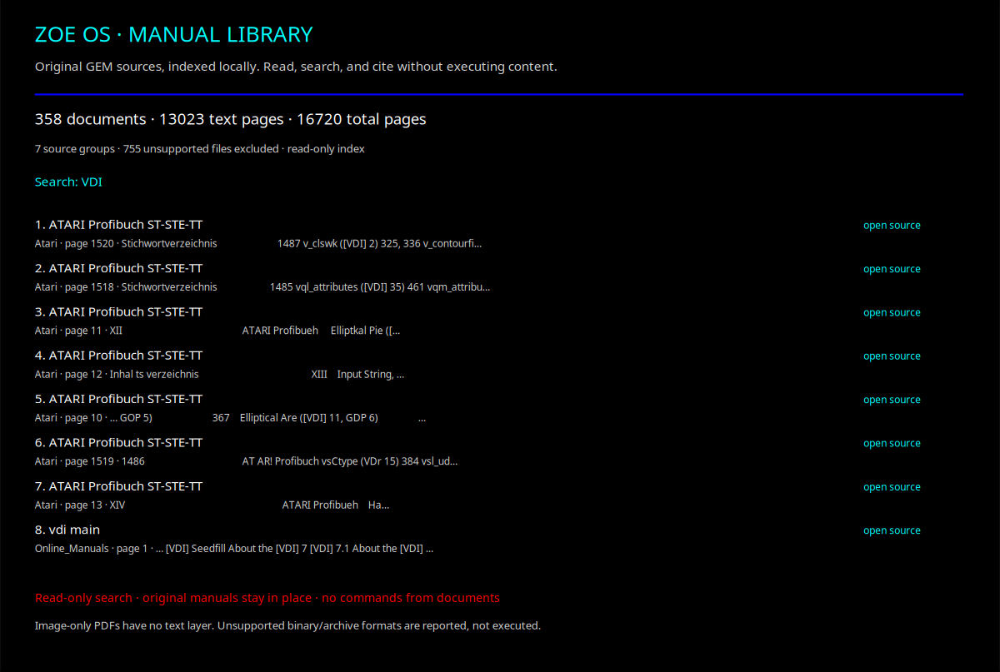

# Zoe OS manual library

The manual library is a **local, read-only search service** inside Zoe OS. It indexes source documents into a new SQLite file, preserves each source's SHA-256 hash, and returns document titles, source groups, page numbers, and snippets. Original manuals are not modified or copied into the repository.



## Build an index explicitly

```bash
python -m gem library index \
  --root /media/cowboy/research/GEM/Books \
  --database "$HOME/.local/share/gem/gem-manuals.sqlite"
```

`--root` accepts a file or directory and can be repeated. The command refuses to overwrite an existing database. PDFs are read with `pdftotext`; HTML tags and script/style content are removed; TXT and Markdown are read as UTF-8 with replacement for malformed bytes. Document text is never evaluated or treated as instructions.

The full supplied scan contains **358 documents**, **16,720 total pages**, and **13,023 text-bearing pages**. It includes **340 indexed documents** and explicitly records **18 documents without a text layer**. It also records **755 unsupported files**, including archives and binary images, which were not executed or silently treated as text. The exact extraction report is in [`evidence/library/index-summary.json`](../evidence/library/index-summary.json).

## Search and inspect

```bash
export GEM_LIBRARY="$HOME/.local/share/gem/gem-manuals.sqlite"
python -m gem library stats --database "$GEM_LIBRARY"
python -m gem library search --database "$GEM_LIBRARY" --query VDI
python -m gem library search --database "$GEM_LIBRARY" --query Artline
```

Queries are bounded, escaped literal phrases rather than executable query-language input. Source paths are returned as data, not commands. The index is opened in SQLite read-only mode for searches.

Open the native library inside Zoe OS:

```bash
python -m gem os --module library
```

Enter a term such as `VDI`, `AES`, `Artline`, or `drivers`, then choose **Search manual index**. The scene displays coverage and up to eight results. **Open first source document** is a separate explicit owner-approved action using the normal desktop opener. Searching does not open documents, launch commands, change posteriors, or execute agents.

To export the current scene without GTK:

```bash
python -m gem os --module library --output zoe-library.svg
```

## Scope and boundaries

- This is a document index, not a new bootable operating system or a claim that the original GPL GEM AES/VDI engine was compiled.
- Image-only PDFs cannot be searched by their image content. OCR is a separate future workflow, not a completed capability.
- Text extraction is bounded: 64 MiB per document, 16 MiB per HTML/text file, and 2 MiB per PDF page. Truncation is recorded explicitly.
- Unsupported archives and binary formats are counted but not opened, extracted, executed, or represented as indexed text.
- Local paths and document snippets are data. No command is accepted from book content, repository text, model output, or another user.
- Zoe's `explicit_command` boundary requires owner approval, rejects shell execution, and refuses root-launched owner commands. It does not prove identity from a name.
- The index and snapshots are local artifacts, not evidence that a claim is true. Cite the original manual and page when reviewing a result.

For the mirrored mathematical workbench, use `gem os` or `gem workbench list`. The manual library is a companion service, not an extra mathematical operation in the 17-entry catalog.
