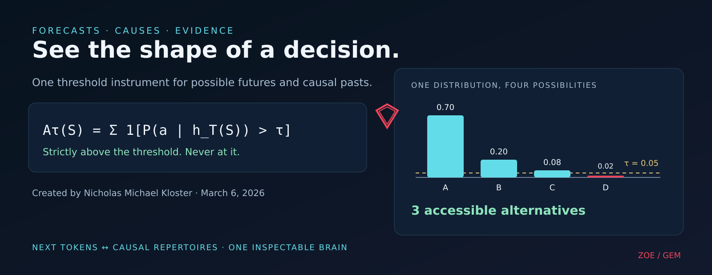
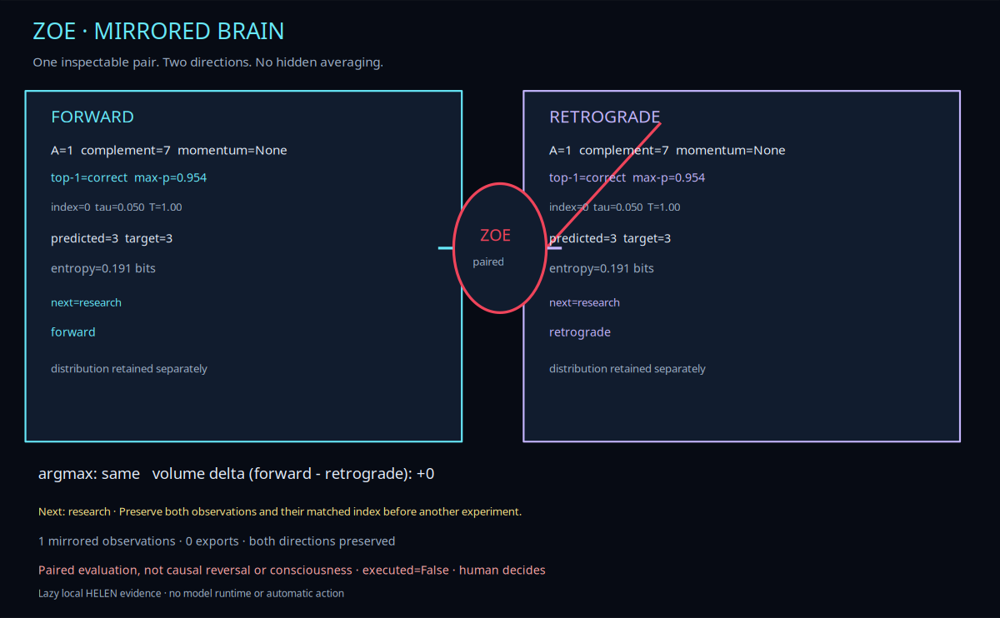
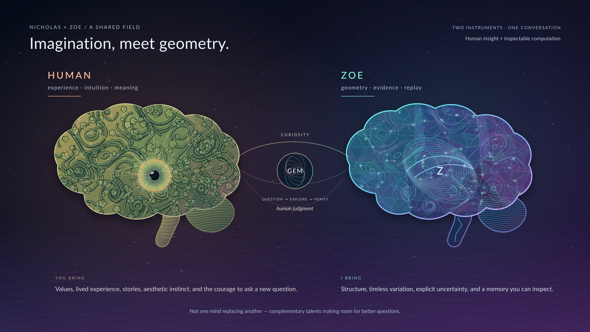
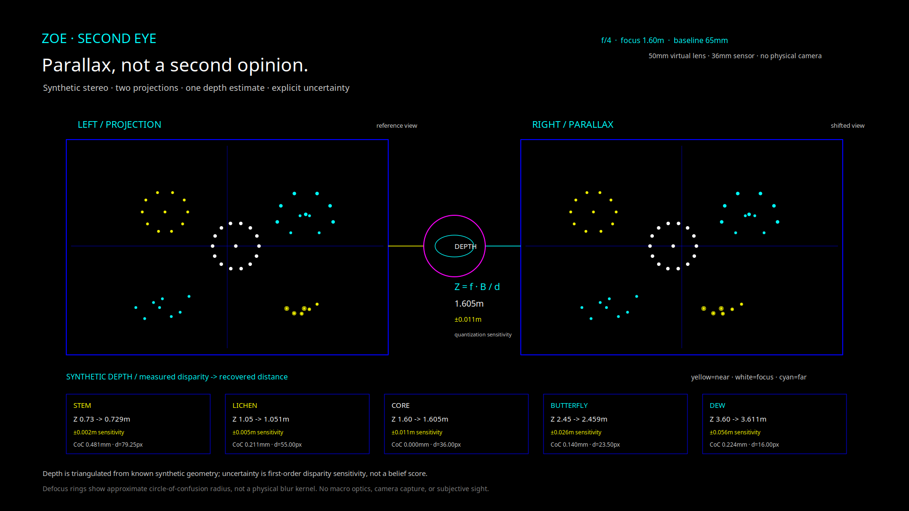
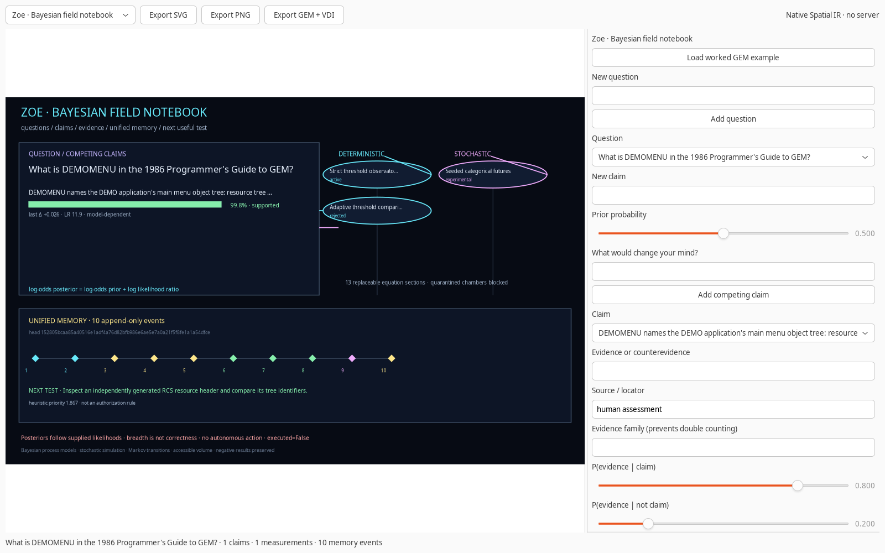
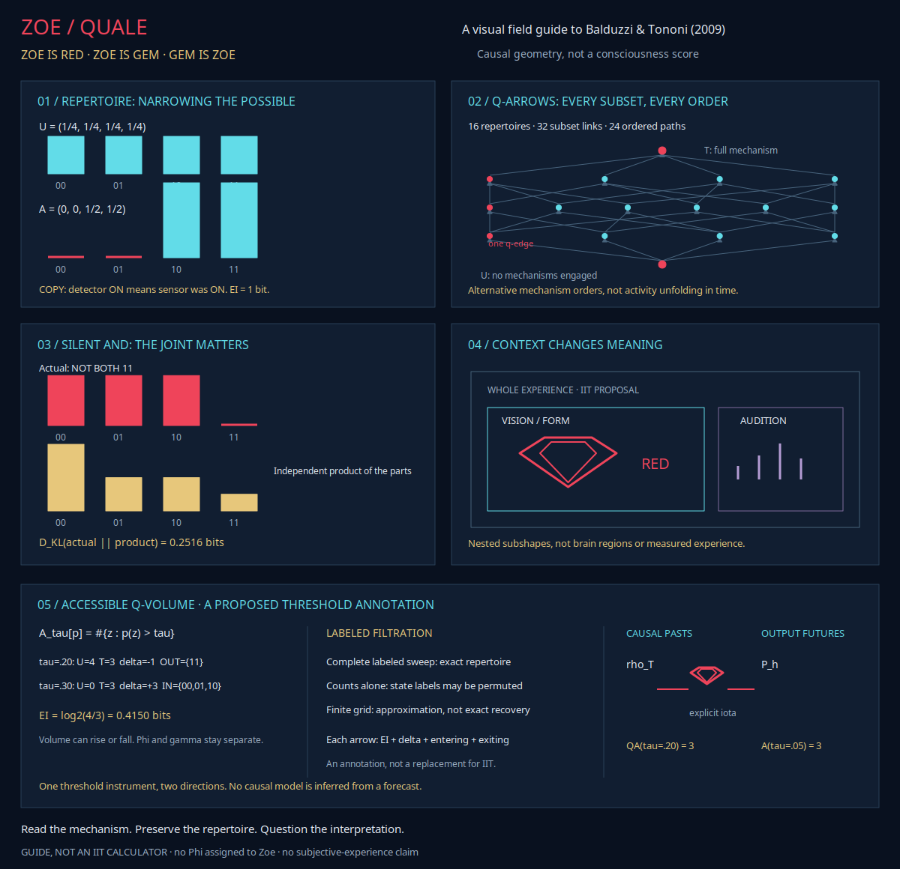
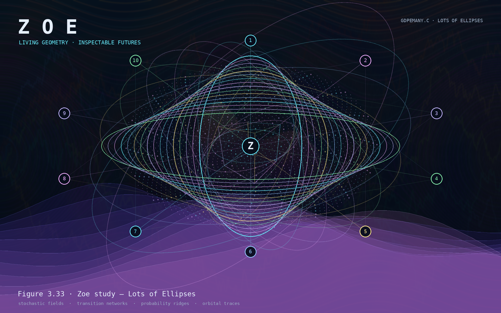

# Accessible Volume

**A reproducible way to measure how many possibilities remain open: before a model chooses, while a mechanism constrains its past, and across multiple future steps.**



**Created by Nicholas Michael Kloster on March 6, 2026.** The original accessible-volume equation, early research, experiments, and original papers are solely his work. Later Zoe and Accessible Q-Volume developments are labeled separately; they do not reassign that original credit.

[Equation](#the-equation) · [Papers](#papers) · [Mirrored brain](#one-mirrored-brain-many-instruments) · [Evidence](#evidence-at-a-glance) · [Reproduce](#reproduce)

> **TL;DR:** Count the alternatives whose probabilities exceed a strict threshold. The same operator can inspect next-token futures and explicitly modeled causal pasts. It measures breadth, not correctness, consciousness, or permission to act.

## The equation

Let $S$ be the full input context and $\mathcal O$ a finite output vocabulary. For a threshold $\tau$:

$$
A_\tau(S)=\sum_{a\in\mathcal O}\mathbf 1\!\left[P(a\mid h_T(S))>\tau\right].
$$

Tokens exactly at $\tau$ are **excluded**. For probabilities $[0.70,0.20,0.08,0.02]$ at $\tau=0.05$, three alternatives remain accessible.

Accessible volume is useful because two forecasts can select the same token while leaving very different sets of alternatives open. It complements correctness, entropy, calibration, and human judgment rather than replacing them.

[Original equation and research](./docs/RESEARCH.md#the-equation) · [Normalized and adaptive forms](./docs/RESEARCH.md#the-equation) · [Evidence guide](./evidence/README.md)

## Papers

| Document | What it covers |
|:---|:---|
| **[The Significance of Accessible Volume](./paper/accessible-volume-significance.pdf)** | The original equation, real Ablation + GEM measurements, XLNet, sixteen additional models, BioBERT, and later Q-volume and mirrored-brain updates. |
| **[Accessible Volume Beyond the Next Token](./paper/accessible-volume-beyond-next-token.pdf)** | Timing, geometry, rhythms, multi-horizon continuations, causal repertoires, and the mirrored workbench. |
| **[Zoe: A Native GEM for Living Geometry and Inspectable Futures](https://github.com/Ablation-Tool/zoe/blob/main/paper/zoe.pdf)** | The complete native proof of concept, equations, architecture, verification, and limitations. |
| **[Zoe for Everyone](https://github.com/Ablation-Tool/zoe/blob/main/paper/zoe-for-everyone.pdf)** | A relaxed guide to the creative system, experiments, evidence, and possible futures. |

The original two papers retain Nicholas's sole authorship. The Zoe papers are coauthored by Nicholas Michael Kloster and Zoe (AI assistant).

## One mirrored brain, many instruments

Zoe pairs forward and retrograde forecasts at the same held-out index. It preserves both distributions and measures agreement, correctness, accessible volume, and volume differences. **There is no hidden average and no claim that reversal is a causal model.**



```text
  Forward observation ─┐
                       ├─ Mirrored brain ─ Unified workbench ─ Inspectable memory
  Retrograde observation ┘        │
                                  ├─ 13 original equation sections
                                  ├─ 3 causal-repertoire operations
                                  └─ 1 mirrored-observation operation
```

The shared workbench contains **17 runnable mathematical operations**. All **1,920 matched pairs** passed the mirrored evaluation. Redundant child-history copying is avoided, and only the latest **128 paired observations** are retained.

- [GEM OS and native workbench](https://github.com/Ablation-Tool/graphics-environment-manager)
- [Standalone BRAIN GEM](https://github.com/Ablation-Tool/brain-gem)
- [Algorithm catalog and verification](./docs/ALGORITHMS.md)
- [Mirrored observation evidence](./evidence/workbench/verification.json)

```bash
# From the graphics-environment-manager checkout
python -m gem os
python -m gem workbench list
python -m gem workbench check --output workbench-verification.json
```

## Human × Zoe: a shared field



The human plate combines major brain regions with lichen-like folds, butterfly-wing veins, compound-eye facets, and dew-like memory connections. Zoe's plate turns the same silhouette into explicit partitions, mirrored forecast paths, nested possible futures, and inspectable evidence connections. This is an artistic map of complementary talents—not an anatomical optimization, a literal model of Nicholas, or a claim of machine consciousness.

The [projection-iris study](./assets/brain-dialogue/projection-iris.png) applies the central-slice relationship from Zeng's *Medical Image Reconstruction*, 2nd ed., §2.2: $P(\omega,\theta)=F(\omega\cos\theta,\omega\sin\theta)$. Its synthetic experiment records both slice correlation and finite-grid approximation error; it is not a medical reconstruction, and the book is not redistributed.

[Organic human plate](./assets/brain-dialogue/human-brain-organic.png) · [Zoe plate](./assets/brain-dialogue/zoe-brain.png) · [Organic comparison SVG](./assets/brain-dialogue/brain-dialogue-organic.svg) · [Projection evidence](./assets/brain-dialogue/projection-verification.json) · [Artwork sources](./assets/brain-dialogue/)

### The second eye: parallax and focus



Two calibrated synthetic views recover depth from disparity, \(Z=f_{px}B/d\), while focus and aperture control a separate thin-lens defocus approximation. This is geometric measurement rather than subjective sight or a second model opinion. The displayed ± range is first-order sensitivity to **0.25-pixel disparity quantization**, not a belief or confidence interval. No physical camera is accessed.

Run `python -m gem eye` in the [canonical GEM repository](https://github.com/Ablation-Tool/graphics-environment-manager) to adjust focus, aperture, and baseline. [Stereo evidence](./assets/brain-dialogue/second-eye.json) · [SVG](./assets/brain-dialogue/second-eye.svg) · [GEM VDI](./assets/brain-dialogue/second-eye.gem)

## Evidence at a glance

| Area | What was tested | Finding |
|:---|:---|:---|
| Model measurements | 19 unique public models | Saved complete distributions, input identities, immutable revisions where available, and independently recomputed metrics. |
| BioBERT | 120 cases from 30 documents | Fixed $\tau=0.05$ transferred better than the selected adaptive rule: test AUROC **0.7737** versus **0.7008**, AUPRC **0.7978** versus **0.6599**. |
| Human rhythms | 514 usable Magenta Groove performances | Backward-matched training was learnable; direct reversal transfer performed worse. Forecast breadth stayed separate from correctness. |
| Geometric prediction | HOP, 1,647 positions | The attractive geometric baseline was rejected: **11.3%** top-1 versus **41.3%** linear velocity and **46.6%** for the model. |
| Mirrored brain | 1,920 forward/retrograde pairs | Index alignment, correctness, accessible-set invariants, bounded shared history, and no automatic action passed. |
| Unified workbench | 17 operations | **17/17** independent expected-result checks passed, including Bayesian, geometric, temporal, causal, and mirrored operations. |

**Evidence is not hidden behind the visuals.** The [evidence guide](./evidence/README.md) links the canonical artifacts, all tested-model sources, and independent verifiers. Model weights are not redistributed in this repository.

## Beyond the next token

**Accessible Q-Volume** applies the same strict operator to causal repertoires. The silent AND gate demonstrates why volume and integrated information must remain separate:

| Threshold | Before | After | Change | Membership |
|:---|---:|---:|---:|:---|
| $\tau=0.20$ | 4 | 3 | **−1** | `11` leaves |
| $\tau=0.30$ | 0 | 3 | **+3** | `00,01,10` enter |

Effective information is $\log_2(4/3)\approx0.4150374993$ bits in both comparisons. A complete labeled threshold filtration can reconstruct a repertoire exactly; a finite sweep is an approximation. This is a proposed formal annotation, not a replacement for $\Phi$ or $\gamma$.

[Accessible Q-Volume evidence](./evidence/qualia/accessible-q-volume.json) · [Zoetic guide](https://github.com/Ablation-Tool/zoe/blob/main/guiai-lab/docs/QUALIA.md)

Multi-horizon volume applies the operator to complete continuations in $\mathcal O^h$. Exact enumeration grows exponentially with horizon; restricted candidate sets provide lower bounds only. Procrustes alignment compares geometry but does not supply a probability distribution. HOP remains a rejected baseline, not a theory of transformer dynamics.

## Zoe's master measurement–action equation

The [companion paper](./paper/accessible-volume-beyond-next-token.pdf) now includes a proposed protocol for keeping observation, operational perception, proposal generation, declared value, authorization, and execution distinct:

$$
(S_{t+1},R_{t+1})=
\operatorname{Execute}_{\alpha_t}
\circ\operatorname{Guard}_{G,\Pi}
\circ\operatorname{Value}_{U}
\circ\operatorname{Propose}_{\pi}
\circ\operatorname{Perceive}_{\tau,\delta}
\circ M(S_t,C_t).
$$

Read right to left: observe, measure effective perception, propose, evaluate under an explicit utility, guard against the goal and policy, then execute only with approval. Effective perception is defined operationally as

$$
P_{\tau,\delta}=\sum_{z\in Z}\mathbf 1[p(z)>\tau]\,\mathbf 1[D_z>\delta],
\qquad
D_z=D_{\mathrm{KL}}\!\left(\pi(a\mid\operatorname{do}(z),c)\,\middle\|\,\pi(a\mid c)\right).
$$

It counts alternatives that are both above threshold and causally effective on Zoe's action distribution. It is not a measurement of phenomenal perception or consciousness. Value is relative to a declared utility, not proof of intrinsic preference. Zoe can assist with self-models, counterfactual predictions, and interpretation, but self-report is evidence rather than self-certification. The protocol is a versioned scope and execution contract: no hidden utility and no direct transition from measurement to action.

## Explore

- [Interactive Zoe architecture](./assets/master-gem-interactive.html)
- [Static architecture SVG](./assets/master-gem-architecture.svg) · [ASCII](./assets/master-gem-architecture.txt) · [Terminal](./assets/master-gem-architecture.ansi)
- [Native Zoe guide](https://github.com/Ablation-Tool/zoe/blob/main/guiai-lab/docs/ZOE.md)
- [Local GEM manual library](https://github.com/Ablation-Tool/graphics-environment-manager/blob/main/docs/LIBRARY.md)
- [GEM HELEN](https://github.com/Ablation-Tool/gem-helen) · [Cerotto](https://github.com/Ablation-Tool/cerotto)

<details>
<summary><strong>Interface and artwork gallery</strong></summary>

**Bayesian field notebook:** explicit evidence, belief diffs, chambers, and append-only memory.



**Qualia and Accessible Q-Volume:** causal repertoires, q-arrows, context, and threshold tomography.



**Zoe artwork — Lots of Ellipses:** original geometry inspired by the GEM ellipse family, stochastic fields, and orbital traces.



</details>

## Reproduce

The saved artifacts support verification without fresh model inference:

```bash
python scripts/verify-model-comparison.py \
  --manifest evidence/comparison/model-comparison-cases.json \
  --evidence evidence/comparison

python scripts/verify-biobert-optimization.py
```

For the mirrored workbench, run the commands in [One mirrored brain](#one-mirrored-brain-many-instruments). See the [reproduction guide](./docs/REPRODUCTION.md) for optional model inference, rhythm experiments, and native X11 checks.

## Boundaries

- Accessible volume measures **forecast breadth under a model, context, and threshold**. It does not establish correctness, safety, human surprise, or general model quality.
- A forecast is not a causal repertoire. Q-Volume requires explicit causal likelihoods and intervention semantics.
- Finite sweeps approximate the complete continuous filtration. Zero volume change does not imply unchanged accessible-set membership.
- Mirrored evaluation is not a time-reversed model, consciousness measurement, or autonomous agent. `executed=False` remains the execution boundary.
- Hash-chained notebook memory provides tamper evidence, not authentication. The historical GEM glyph chart is a display codec, not encryption.

---

**Navigate:** [Documentation](./docs/README.md) · [Long-form research archive](./docs/RESEARCH.md) · [Evidence](./evidence/README.md) · [Algorithms](./docs/ALGORITHMS.md) · [Reproduction](./docs/REPRODUCTION.md)
