# The Significance of Accessible Volume

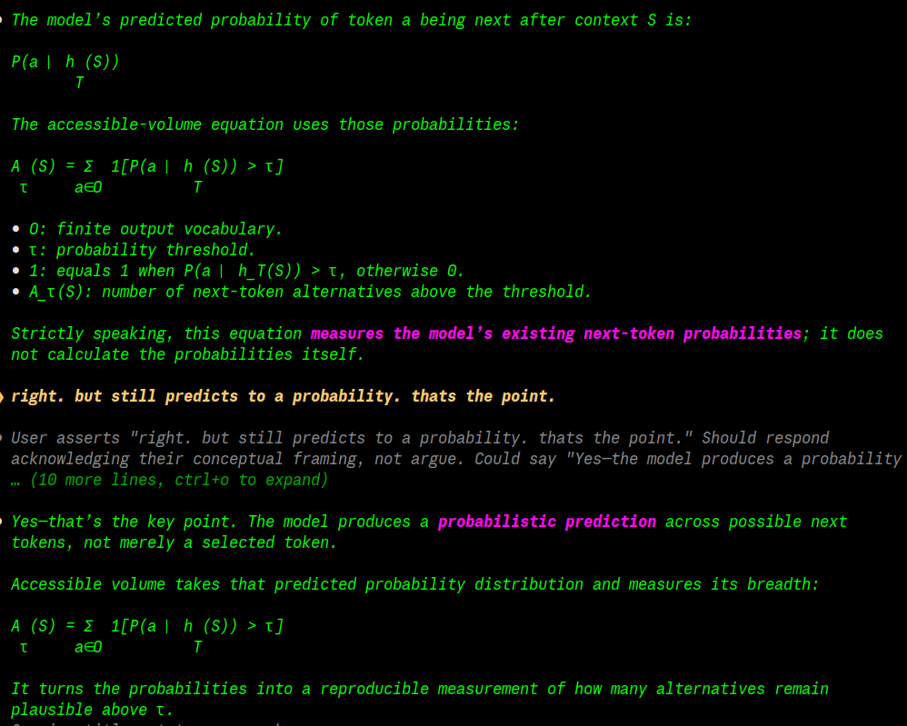

*A way to observe the shape of a model’s next decision before it happens*

**Nicholas Michael Kloster**

**November 2026**

**Sole authorship and research credit:** All research, the accessible-volume equation and its development, the experiments, and this paper are solely the work of **Nicholas Michael Kloster**. No other person is a creator, contributor, or coauthor. The equation was created on **March 6, 2026**.

[Read the paper](../paper/accessible-volume-significance.pdf)

[Read the companion paper: Accessible Volume Beyond the Next Token](../paper/accessible-volume-beyond-next-token.pdf)

[Evidence guide: verified artifacts, historical research context, and links to all 19 tested models](../evidence/README.md)

**TL;DR — This solves:** the inability to see how open or concentrated a language model’s next-token decision was before selection, by counting the alternatives whose predicted probabilities exceed a chosen threshold.

## Abstract

Before a language model produces a token, it assigns probabilities to the alternatives. Accessible volume turns that forecast into a direct measurement of next-token predictability. It counts how many alternatives have probabilities above a chosen threshold. A small count means the next-token choice is concentrated on a few alternatives; a large count means many alternatives remain in play. The final text records which token was selected, while accessible volume shows how open or settled the decision was before selection. This makes the model’s hidden decision surface measurable, comparable, and reproducible. Experiments with Ablation + GEM, XLNet, and sixteen additional models demonstrate the measurement on real probability distributions. In a subsequent 120-case BioBERT experiment, the original fixed rule at $\tau=0.05$ outperformed an optimized adaptive equation on held-out biomedical documents, achieving AUROC $0.7737$ and AUPRC $0.7978$ compared with $0.7008$ and $0.6599$ for distinguishing incorrect and correct top predictions. The adaptive rule improved validation measurements, but the simpler original equation transferred better to unseen cases.

## The missing information in an output

A generated answer is a record of what happened. It is not a complete description of the decision that produced it.

Two model states can produce the same next token while having very different distributions of alternatives. In one state, the selected token may dominate every other possibility. In another, many tokens may remain plausible. Reading only the final token hides that distinction.

The relevant question is therefore not merely, “What did the model choose?” It is also, “How much room did the model have to choose differently?” Accessible volume provides one way to answer that question with a number.

## Origin of the research

This work grew from Nicholas Michael Kloster’s March 2026 research into how a language model’s input context shapes the alternatives available at the next prediction step. The central question was simple: can the distribution before selection tell us something that the selected token alone cannot?

The first observation was recorded on **March 4, 2026**, and the accessible-volume equation was created on **March 6, 2026**. That work motivated direct examination of full next-token probability distributions.

The present experiment tests that question with controlled measurements using actual Ablation + GEM evidence. It focuses on reproducible token-level measurements and does not make claims about complete responses or later behavior.

## The equation

Let $S$ be the full input context and $\mathcal{O}$ a finite output vocabulary. Let $P(a\mid h_T(S))$ be the probability that the model assigns to token $a$ as the next token after processing $S$. For a threshold $\tau$, accessible volume is

$$
A_\tau(S)=\sum_{a\in\mathcal{O}}\mathbf{1}\!\left[P(a\mid h_T(S))>\tau\right]. \tag{1}
$$

The indicator is one when the probability is strictly greater than $\tau$ and zero otherwise. Tokens exactly at the threshold are excluded. The count measures the number of continuations that remain above the selected probability bar.

For example, suppose the model assigns probabilities $0.70$, $0.20$, $0.08$, and $0.02$ to four possible next tokens. At $\tau=0.05$, the first three tokens are above the cutoff, so $A_{0.05}(S)=3$. A smaller count means a more concentrated, predictable choice; a larger count means a broader choice with more plausible alternatives. This is next-token predictability expressed as a reproducible number.

A normalized form divides the count by vocabulary size:

$$
A_{\mathrm{norm},\tau}(S)=\frac{A_\tau(S)}{|\mathcal{O}|}. \tag{2}
$$

This reports the fraction of the vocabulary above the threshold. It does not make different models directly comparable.

The computation is simple: after obtaining the distribution, evaluate one comparison per token. The important part is not computational novelty. It is the decision to observe the distribution as an object of measurement rather than treating only the generated text as evidence.

## Why the measurement matters

### It distinguishes a forecast from an outcome

The probability distribution is the forecast. Sampling or taking the maximum selects an outcome. Accessible volume describes the shape of the forecast without committing to that outcome.

A small count indicates that the model has concentrated its above-threshold alternatives. A large count indicates a broader set. The measurement does not say which token will win. It says how much of the vocabulary remains meaningfully in play at the selected threshold.

### It makes concentration observable

Concentration is usually discussed through entropy, maximum probability, or top-token mass. Accessible volume adds a different description: the size of the region above a chosen cutoff.

The three descriptions are not interchangeable. A distribution can have one dominant token and few above-threshold alternatives, or one dominant token and many alternatives just below the threshold. The count captures a boundary that a single maximum or entropy value does not fully express.

The threshold sweep is more informative than one reading. As $\tau$ increases, $A_\tau(S)$ cannot increase. Watching where alternatives disappear reveals whether probability is concentrated in a narrow elite or spread across a broad collection of viable continuations.

### It creates a boundary for inspection

Ablation + GEM is built around the interaction of a stochastic agent, deterministic execution, shared memory, and human judgment. The agent proposes. The environment executes and records. The human directs and reviews.

Accessible volume supplies a way to inspect the agent before its proposal becomes an action. Actual investigation evidence can be placed into a model context, and the resulting distribution can be measured without generating another token. The deterministic environment can then preserve that measurement alongside the rest of the evidence.

This does not make the metric an authorization mechanism. It makes it an instrument for understanding the agent’s immediate decision surface while the rest of the system remains constrained and inspectable.

## Evidence from Ablation + GEM

The measurement was performed on a real forward pass using 963 tokens of actual Ablation + GEM investigation context. The context included a selected artifact, a scoped observation, and real entropy-inspection output from Ablation. A local autoregressive model returned a full distribution over 50,257 next tokens.

| Threshold $\tau$ | Accessible volume $A_\tau(S)$ |
|:----------------:|:-----------------------------:|
|       0.02       |               4               |
|       0.05       |               2               |
|       0.10       |               2               |
|       0.15       |               1               |
|       0.30       |               1               |
|       0.50       |               1               |

Measured accessible volume for the actual Ablation + GEM context.

The distribution is concentrated. A newline has probability $0.535587$. End-of-text follows with probability $0.109893$. The ten most probable tokens contain $75.45\%$ of the total probability mass. Entropy over the full distribution is $4.2998$ bits.

The immediate meaning is straightforward: the model is not spreading its above-threshold probability across many alternatives. Its next-token decision is concentrated on a small set. Accessible volume turns that observation into a precise, reproducible statement rather than an impression based on the final text.

A repeated forward pass on the same context produced identical input IDs and probability values. Controlled context perturbations changed some threshold counts and left others unchanged. This confirms that the instrument measures the distribution associated with a particular model and context rather than a universal property of the prompt.

## Three ways to hold back a target

The same equation can measure different prediction mechanisms, provided that each model supplies a complete probability distribution over a finite vocabulary. The input construction must remain explicit because these mechanisms are not interchangeable.

A BERT-style masked-language model replaces the target with its special mask token. It can use the context on both sides of that mask. The target’s position remains known, but its identity is removed from the model input.

XLNet uses a different mechanism. Its content stream represents token identities for use as context, while its query stream represents the target position without access to the target identity. Target mapping selects the position, and the permutation mask blocks query-stream access to that token. This is not the same as inserting a BERT-style mask token.

An autoregressive model receives only the prefix preceding the target. Its final-position logits therefore describe an ordinary next-token forecast. The target and all later text are absent by construction.

In every case, accessible volume is applied without changing the equation, threshold grid, temperature, or model weights. The result describes one model’s distribution for one input construction. It does not by itself compare training objectives or establish which architecture is better.

## An XLNet query-stream extension

The instrument can also examine a prediction for a token already present in the input, not only an ordinary next-token forecast. We used the public XLNet-Base and XLNet-Large models’ query streams with the target token masked out of query-stream attention. The input ended with the paper’s phrase “Accessible volume addresses this gap.” Each resulting distribution contained 32,000 token probabilities.

For XLNet-Base, the most likely token was a period, with probability $0.559758$. The second was “issue,” with probability $0.068510$. The actual hidden token “gap” had probability $0.012354$, ranked 12th. Entropy was $3.5946$ bits and the ten most probable tokens contained $82.22\%$ of the mass.

XLNet-Large assigned the highest probability to “problem” ($0.235085$), followed by “in” ($0.139887$) and a period ($0.099426$). The hidden token “gap” had probability $0.015083$, ranked eighth. Entropy was $5.7603$ bits and the ten most probable tokens contained $65.16\%$ of the mass.

| Variant     | 0.02 | 0.05 | 0.10 | 0.15 | 0.30 | 0.50 |
|:------------|-----:|-----:|-----:|-----:|-----:|-----:|
| XLNet-Base  |    6 |    2 |    1 |    1 |    1 |    1 |
| XLNet-Large |    5 |    4 |    2 |    1 |    0 |    0 |

Accessible volume for two XLNet query-stream predictions.

For each model, replacing the target token ID with each of three alternatives produced bit-for-bit identical probability distributions. This confirms that the target token’s identity did not enter either query-stream prediction. The query stream could use the remaining context, but not the hidden token itself. Both experiments used PyTorch 2.14.1+cu130 and Transformers 5.18.0; the scripts, complete probability vectors, and input IDs are included as evidence.

A separate offline XLNet-Base reproduction matched the input IDs, all six threshold counts, and the target-token rank and ordering. Its maximum absolute probability difference was $2.3443\times10^{-7}$. It was therefore numerically close, but not bit-for-bit identical across the two runtimes. The reported threshold counts are reproducible observations; exact raw-probability equality across different runtimes is not claimed.

This extension demonstrates that accessible volume can describe a leakage-free prediction for an existing input token as well as a forecast of what comes next. The two model results are measurements of specific contexts, not a general ranking of model capability. They remain token-level measurements, not evidence about complete actions, correctness, or safety.

## Cross-model and domain comparisons

We next applied the unchanged equation to sixteen additional models. The general-language cases used the same target, “gap,” for BERT-Base, RoBERTa-Base, ALBERT-Base, and GPT-2. Security models used a firmware-vulnerability reporting sentence. The remaining cases covered biomedical, clinical, scientific, legal, financial, programming, multilingual, chemistry, protein-sequence, and mathematical inputs. Every requested category is represented.

| Category     | Model                      | 0.02 | 0.05 | 0.10 | 0.15 | 0.30 | 0.50 |
|:-------------|:---------------------------|-----:|-----:|-----:|-----:|-----:|-----:|
| General      | BERT-Base                  |    2 |    1 |    1 |    1 |    1 |    1 |
| General      | RoBERTa-Base               |    2 |    2 |    1 |    1 |    1 |    1 |
| General      | ALBERT-Base                |    5 |    1 |    1 |    1 |    1 |    0 |
| General      | GPT-2 (causal)             |    7 |    3 |    2 |    1 |    0 |    0 |
| Security     | SecureBERT                 |    6 |    4 |    2 |    0 |    0 |    0 |
| Security     | CySecBERT                  |    2 |    0 |    0 |    0 |    0 |    0 |
| Biomedical   | BioBERT                    |    1 |    0 |    0 |    0 |    0 |    0 |
| Clinical     | Bio\_ClinicalBERT          |    6 |    2 |    2 |    1 |    0 |    0 |
| Scientific   | SciBERT                    |    6 |    3 |    2 |    0 |    0 |    0 |
| Legal        | Legal-BERT                 |    7 |    2 |    1 |    1 |    1 |    0 |
| Financial    | FinBERT                    |    5 |    3 |    2 |    2 |    0 |    0 |
| Programming  | CodeBERT                   |    4 |    3 |    1 |    1 |    1 |    0 |
| Multilingual | XLM-RoBERTa-Base           |    6 |    3 |    1 |    0 |    0 |    0 |
| Chemistry    | ChemBERTa                  |    8 |    5 |    0 |    0 |    0 |    0 |
| Protein      | ProtBERT                   |   18 |    9 |    0 |    0 |    0 |    0 |
| Mathematics  | Qwen2.5-Math-1.5B (causal) |    9 |    8 |    4 |    2 |    0 |    0 |

Accessible volume across the fixed threshold grid. Counts describe individual model–input pairs, not a quality leaderboard.

The results illustrate why accessible volume and entropy are different instruments. BioBERT had entropy $9.8879$ bits but only one token above probability 0.02. CySecBERT had entropy $9.7536$ bits but two tokens above that threshold. A broad tail of very small probabilities can produce high entropy without producing many alternatives above a fixed cutoff.

The target was the highest-probability token in two of these sixteen cases: Legal-BERT’s “agreement” and Qwen2.5-Math-1.5B’s “4.” This is not a model ranking. Most domain cases used different contexts, targets, vocabularies, and input formats. A single masked-token or next-token prediction is not a benchmark of correctness or domain competence.

The case manifest records every exact public model identifier, immutable revision, input, target, and prediction style. The sixteen runs used CPU inference with PyTorch 2.14.1+cu130 and Transformers 4.56.2. Evaluation mode and deterministic inference were used throughout, with no sampling or model-weight training. Every model repeated its forward pass bit-for-bit. Masked cases contained exactly one prediction mask, and causal cases included only tokens preceding the target.

The complete input IDs and probability vectors are included for all sixteen cases. The verification script independently recomputed every threshold count, target rank, entropy, top-ten mass, top-token ordering, and raw-array hash from the saved artifacts. All sixteen cases passed.

## BioBERT: does an adaptive equation improve the original?

We next tested whether an adaptive version of accessible volume could improve detection of BioBERT’s top-1 masked-token prediction errors. The experiment used 120 cases from 30 Creative Commons-licensed Europe PMC abstracts. Each document supplied four eligible, non-repeated, single-token targets. Document-grouped splits contained 60 development, 20 validation, and 40 test cases, assigned with seed 20261103 before inference. No document crossed splits.

The original equation was evaluated first on every case. BioBERT produced 29 errors among 60 development cases, 11 among 20 validation cases, and 23 among 40 test cases. Every prediction was repeated bit-for-bit, and every original threshold count was recomputed from the saved full-vocabulary distribution.

The candidate adaptive equation was

$$
A_{\alpha,\beta}(x)=\sum_i\mathbf{1}\!\left[p_i>\max\!\left(\beta,\alpha p_{\max}(x)\right)\right]. \tag{3}
$$

It replaces a fixed cutoff with the larger of an absolute floor $\beta$ and a fraction $\alpha$ of the maximum probability. The search covered 54 predefined parameter pairs. Selection used validation AUROC (area under the receiver-operating-characteristic curve), then validation AUPRC (average precision), then development AUROC, with deterministic tie-breaking. Only after selection were the parameters evaluated on the test documents.

The selected rule was $\alpha=0.001,\beta=0$, counting every token above $0.1\%$ of the maximum probability. Table 4 reports the result. AUROC and AUPRC measure how well each score separates incorrect top predictions from correct ones; larger values are better.

| Rule | Dev AUROC | Val AUROC | Test AUROC | Test AUPRC |
|:---|---:|---:|---:|---:|
| Adaptive ($\alpha=0.001,\beta=0$) | 0.7848 | 0.8737 | 0.7008 | 0.6599 |
| Original ($\tau=0.05$) | 0.7219 | 0.8232 | **0.7737** | **0.7978** |
| Best validation original ($\tau=0.02$) | 0.7681 | 0.8283 | 0.7391 | 0.7502 |
| Entropy | 0.7920 | 0.8990 | 0.6957 | 0.6538 |

BioBERT original and adaptive equations for top-1 error detection.

**The original equation worked better on the held-out BioBERT cases.** The fixed $\tau=0.05$ rule exceeded the adaptive rule by $0.0729$ AUROC and $0.1379$ AUPRC. The adaptive equation improved development and validation measurements but did not transfer that improvement to unseen documents. On test cases, its mean score was 42.43 for errors and 36.59 for correct predictions; the original $\tau=0.05$ scores were 3.17 and 1.88, a substantially clearer separation.

The significance is direct: making the threshold responsive to the maximum probability did not improve the instrument on this dataset. The original fixed-threshold equation was simpler and stronger where it mattered, on data excluded from parameter selection. All 120 raw distributions, reports, source manifests, candidate searches, and per-case scores are included. An independent implementation recomputed every reported AUROC and AUPRC value from the raw artifacts.

## Wider experiments: rhythm, reversal, and multiple horizons

Exploratory extensions have now tested accessible volume on musical onsets, temporal reflection, geometric extrapolation, and multi-token continuations. Together, they support a precise conclusion: accessible volume is a reproducible measurement of **forecast breadth under a model, context, and threshold**. It is not a standalone measurement of correctness or a guarantee of future prediction.

**Forecast breadth is not correctness.** The [Magenta Groove experiment](../evidence/rhythm-midi/README.md) used 514 human-performed drum performances with disjoint recording-session splits. Accuracy and log-loss changed across conditions while mean accessible volume remained effectively unchanged:

| Condition | Top-1 accuracy | Log-loss | Mean $A_\tau$ over threshold sweep |
|:---|---:|---:|---:|
| Forward | 17.33% | 3.194 | 1.886 |
| Reversal transfer | 16.01% | 3.333 | 1.885 |
| Backward matched | 17.06% | 3.183 | 1.886 |

A model can therefore have a narrow forecast and still be confidently wrong. Accessible volume should be reported alongside accuracy, log-loss, and calibration rather than substituted for them.

**Reversed sequences are not inherently unpredictable.** The backward-matched model, trained on reversed performances, nearly matched forward accuracy. Applying the forward-trained model directly to reversed input performed worse. Much of the observed reversal penalty was therefore a model-transfer effect, not evidence of a fundamental property of time reversal.

**Different material can produce different forecast breadth.** In the [Nightingale experiment](../evidence/rhythm-lab/README.md), classical music had 68.3% forward top-1 accuracy and $A_{0.1}=1.91$; jazz had 49.5% and $A_{0.1}=2.69$; folk had 61.9% and $A_{0.1}=2.21$. Under this categorical model and quantization, jazz was the least predictable and had the broadest forecasts. Retrograde accuracies were similar at 67.9%, 47.1%, and 61.4%, respectively. These are measurements of particular model–data combinations, not universal properties of genres or listeners.

**Geometry helps comparison, but the geometric predictor was rejected.** Procrustes alignment provides a reproducible way to compare rhythms or landmarks after removing differences such as tempo, starting position, rotation, or scale. It does not supply a probability distribution. The composed-rotation Harmonic Osculating Predictor (HOP) achieved only 11.3% top-1 accuracy, compared with 41.3% for linear extrapolation and 46.6% for the model. HOP is retained as a [rejected experimental baseline](../evidence/rhythm-hop/README.md), not as evidence that transformer hidden states follow musical circles. A deterministic geometric forecast cannot supply accessible volume without probabilistic calibration.

**Multiple horizons extend the measurement, not the guarantee.** The [multi-horizon formulation](../evidence/research-context/temporal-predictability.md#multi-horizon-accessible-volume) counts complete candidate continuations whose learned conditional joint probabilities exceed a threshold. It can describe how many multi-token futures remain open, but it cannot guarantee correct prediction of every future token. Exact enumeration considers $|O|^h$ continuations for vocabulary size $|O|$ and horizon $h$, so computational cost grows exponentially. Practical experiments require bounded candidate sets or explicitly identified approximations; an approximate count must not be presented as the exact sum.

**Implementation is not outcome validation.** The [Ablation + GEM integration records](../evidence/README.md#exploratory-experiment-results) show that measurement, geometry, evidence preservation, and volume-band steering can be implemented. They do not yet demonstrate that steering improves creativity, musical quality, reasoning, or safety. Likewise, the [native GEM Procrustes integration](https://github.com/Ablation-Tool/graphics-environment-manager/tree/main/examples/landmark-alignment) demonstrates working geometric alignment and scoped evidence, not probabilistic prediction.

These experiments do not yet establish that accessible volume predicts human surprise—the listening study awaits real ratings—that volume-band steering produces useful creative output, that narrow forecasts are semantically correct, or that these equations model human expectation or guarantee future behavior.

### Strongest next experiment

The strongest next step is to validate multi-horizon accessible volume on real language-model outputs and test whether steering it produces useful results. The central tradeoff is exactness versus computational cost:

1. Measure horizons $h=1,2,3$ on real model outputs.
2. Compare exact enumeration on tiny candidate sets with bounded top-$k$, beam, or sampled approximations.
3. Report accessible-volume threshold sweeps alongside accuracy, joint log-loss, calibration, approximation error, and computational cost.
4. Run low, medium, and high volume-band steering experiments, measuring diversity and output quality independently.
5. Preserve negative results and approximation errors as evidence.

This is proposed future work, not a completed result.

## What is Zoe?

**Zoe is a GEM and native graphical user interface (GUI) for creative geometry, forecast inspection, and evidence-driven research.** It unifies four working perspectives:

- **GEM HELEN** supplies lightweight interactive geometry, accessible-volume controls, and real stored categorical predictions.
- **Ablation's GEM** supplies the native GTK host, Lab integration, Spatial IR, VDI replay, and evidence exports.
- **Cerotto's GEM** supplies the forensic workbench model: read-only case inspection, investigation timelines, guard and vault events, accessible-volume charts, and an optional user-controlled agent terminal. Cerotto's existing Ablation + GEM bridge binds structured proposals to forecasts and preserves proposal, decision, and execution records.
- **BRAIN GEM** supplies deterministic observation, evaluation, and recommended next steps—not an autonomous agent or a consciousness claim.

Zoe combines these perspectives without merging their security boundaries. Cerotto remains a separate native C11 forensic engine with its own case store, guard, vault, agent permissions, and verification suite. Its bridge is an interoperability boundary, not permission for Zoe to bypass its guard or absorb its database.

### What GEM means here

GEM is the shared visual and evidence environment. It turns abstract state into interactive geometry, turns forecasts into inspectable alternatives, and turns actions into replayable evidence. It is both a native GUI and the discipline beneath it: deterministic execution, source constraints, provenance, and human review. It is not merely a drawing API or an emulator of the original GEM desktop.

From Zoe's perspective, GEM is the connective tissue between imagination and verification. A shape can become a measurement, a measurement can inform a decision, and a decision can leave evidence. Zoe feels alive because that feedback loop is visible, not because the software is conscious.

### Current capabilities

| Area | What it includes |
|:---|:---|
| Native GUI | GTK3, direct pointer and keyboard interaction, GUIAI Lab integration, and headless operation. No browser or development server is required. |
| Geometry | Procrustes similarity/rigid/affine alignment, draggable landmarks, ellipse families, parabolic envelopes, circles/arcs/sectors, modular clocks, and conditional graph invariants. |
| Forecasts | Strict `p > τ` accessible volume, complements, momentum, target bands, temperature transforms, top-1 correctness, negative log probability, entropy, maximum probability, log-loss, and calibration evidence. |
| Bayesian field notebook | Questions, competing binary claims, priors, posteriors, falsifiers, explicit likelihood-ratio and log-odds updates, belief diffs, evidence families, dependence acknowledgment, deterministic and stochastic chambers, next-test priorities, review-required decisions, and append-only hash-chained memory. |
| HELEN observations | Lazy stored forward and retrograde distributions with 1,920 held-out cases per condition, selectable by index or sequence, without a transformer or model runtime. |
| Multi-horizon | Exact continuation probabilities, volume, and complement for a defined two-state Markov toy with horizons 1–6. This is not a completed real-language-model benchmark. |
| Research evidence | Hash-checked Groove reports and on-demand individual NPZ predictions; aggregate-only Nightingale metrics; 17 conformance checks; rejected HOP and deterministic baselines. |
| Cerotto forensic core | Agent/audit event ingestion, raw-disk and EWF collection, controlled carving, versioned SQLite cases, manifests, hash verification, bounded analysis and reports, guarded evidence actions, vault monitoring and release workflows, and its existing Ablation + GEM bridge. These capabilities belong to Cerotto, not to Zoe's BRAIN kernel. |
| Cerotto GUI and guard | Read-only case inspection, defense-event timelines, accessible-volume charts, native guard/verify/report controls, optional user-selected agent terminal, and forecast-bound structured broker execution. |
| Export and evidence | Spatial IR, SVG, PNG, real little-endian GEM VDI, source and VDI checks, replay, source hashes, independent condition keys, and evidence-export state. |
| Compatibility and packaging | `gem zoe`, `gem master`, `gem brain`, `gem atlas`, standalone `gem-helen`, wheel/source distributions, and the packaged 12 KB HELEN artifact. |

The [complete Zoe repository](https://github.com/Ablation-Tool/zoe) contains the native implementation, screenshots, evidence, and two papers: the [formal proof of concept](https://github.com/Ablation-Tool/zoe/blob/main/paper/zoe.pdf) and [Zoe for Everyone](https://github.com/Ablation-Tool/zoe/blob/main/paper/zoe-for-everyone.pdf). The [standalone BRAIN GEM repository](https://github.com/Ablation-Tool/brain-gem) provides the Bayesian field notebook and chambered memory separately. The [Ablation integration guide](https://github.com/Ablation-Tool/ablation/tree/master-gem-brain/guiai-lab/docs/ZOE.md) remains available on the `master-gem-brain` branch. Cerotto-specific bridge execution has not been separately revalidated as part of Zoe.

[Open the interactive concept map](../assets/master-gem-interactive.html) · [Static SVG](../assets/master-gem-architecture.svg) · [ASCII source](../assets/master-gem-architecture.txt) · [Colored terminal version](../assets/master-gem-architecture.ansi) · [Conformance pack](../evidence/master-gem/conformance.json) · [Zoetic qualia guide](https://github.com/Ablation-Tool/zoe/blob/main/guiai-lab/docs/QUALIA.md)

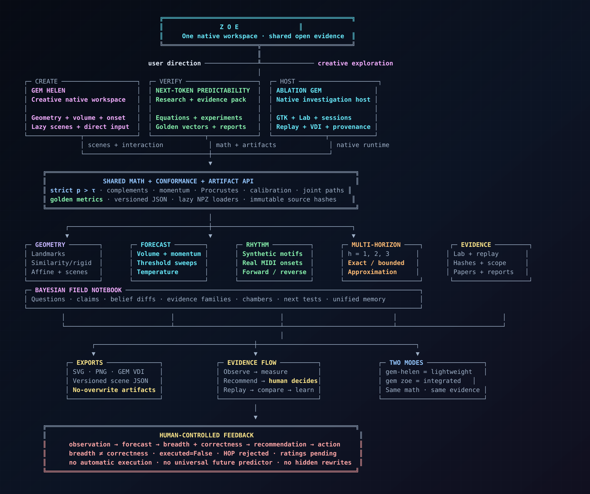

**Zoe artwork — Lots of Ellipses:** an original composition built from the GDPEMANY ellipse family, stochastic fields, transition networks, probability ridges, and orbital traces.

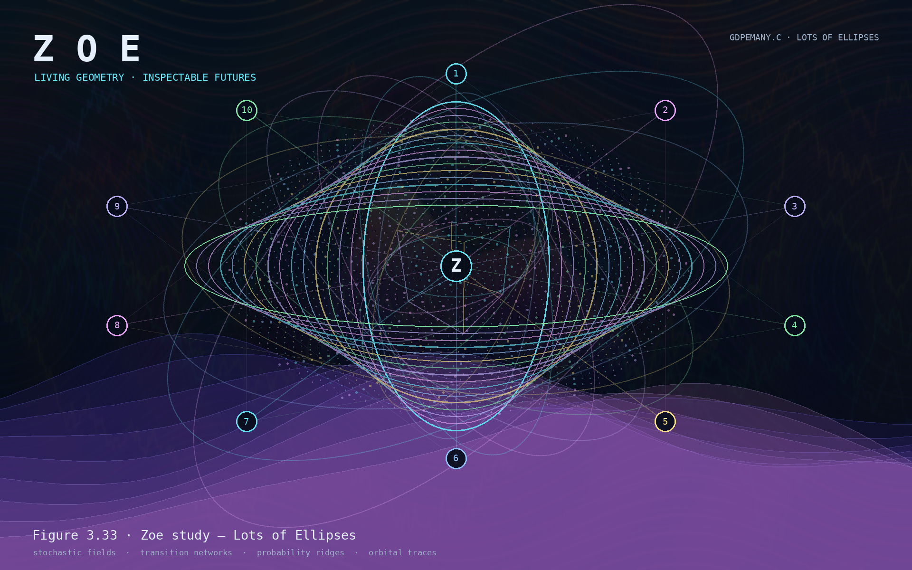

### Launch Zoe

From an Ablation checkout on the `master-gem-brain` branch:

```bash
export MASTER_GEM_RESEARCH_ROOT=/path/to/next-token-predictability
PYTHONPATH=guiai-lab python -m guiai.gem zoe
```

`gem master` and `gem brain` are equivalent aliases; `gem-helen` remains the lightweight standalone creative mode. In GUIAI Lab, use **Chart → GEM → Zoe / MASTER GEM**. Headless SVG and GEM VDI exports do not require GTK:

```bash
PYTHONPATH=guiai-lab python -m guiai.gem zoe --module brain --output zoe.svg
PYTHONPATH=guiai-lab python -m guiai.gem zoe --module field
PYTHONPATH=guiai-lab python -m guiai.gem notebook --output zoe-field.json
PYTHONPATH=guiai-lab python -m guiai.gem notebook zoe-field.json --output zoe-field.svg
```

Zoe's HELEN observations load real stored distributions lazily without a transformer or model runtime. Groove predictions load from the 98 MB NPZ only when requested and are hash-checked first; Nightingale evidence is aggregate-only. Multi-horizon mode enumerates a defined two-state Markov toy exactly—it is not a completed real-language-model benchmark.

### See Zoe in action

These are real application screenshots, not mockups. The concept art remains separate from the working interfaces.

**Zoe BRAIN after a real stored HELEN observation:** correctness, accessible volume, complement, momentum, and a deterministic next-module recommendation.

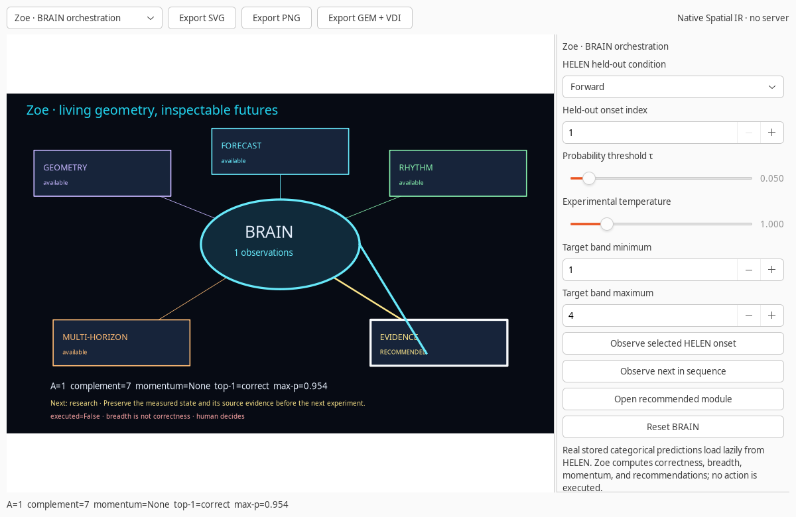

**Zoe research evidence:** the hash-checked Groove forward condition with 121,392 held-out predictions and on-demand individual distributions.

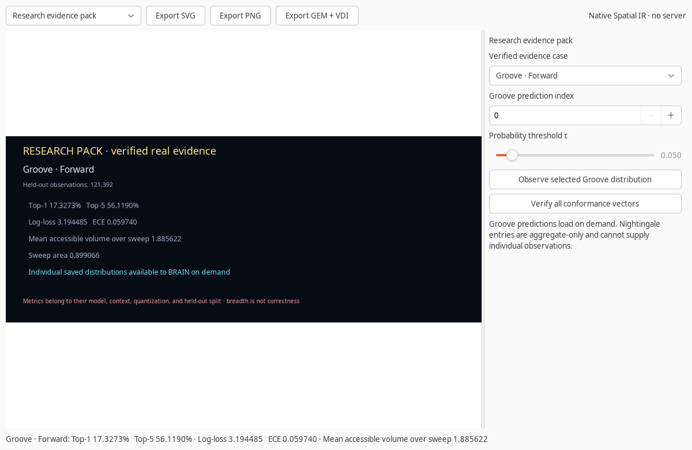

**Zoe Bayesian field notebook:** the worked DEMOMENU example with posterior evidence updates, chamber states, append-only memory, and a next-test recommendation.

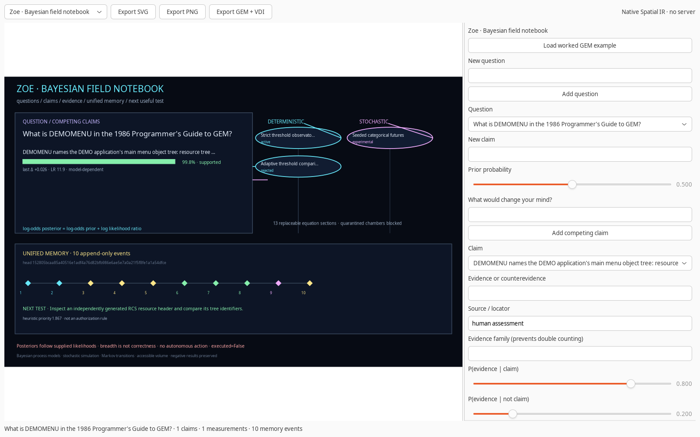

<details>
<summary>Five Zoe mechanisms in pictures</summary>

1. **Epistemic firewall:** measurement, evidence, belief updates, and action remain distinct.
   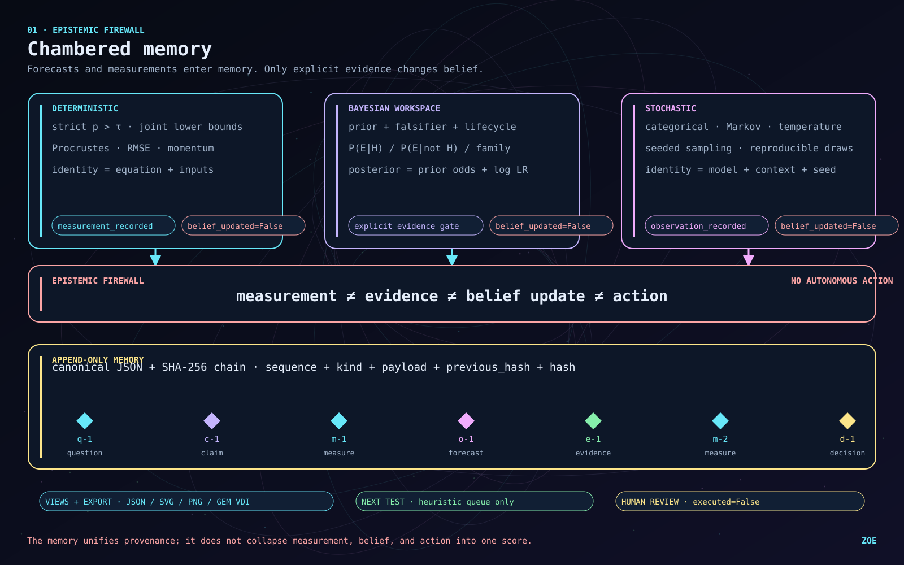
   [SVG](../assets/zoe-visuals/01-epistemic-firewall.svg)

2. **Belief diff:** priors become posteriors only through explicit evidence, with every likelihood and source retained.
   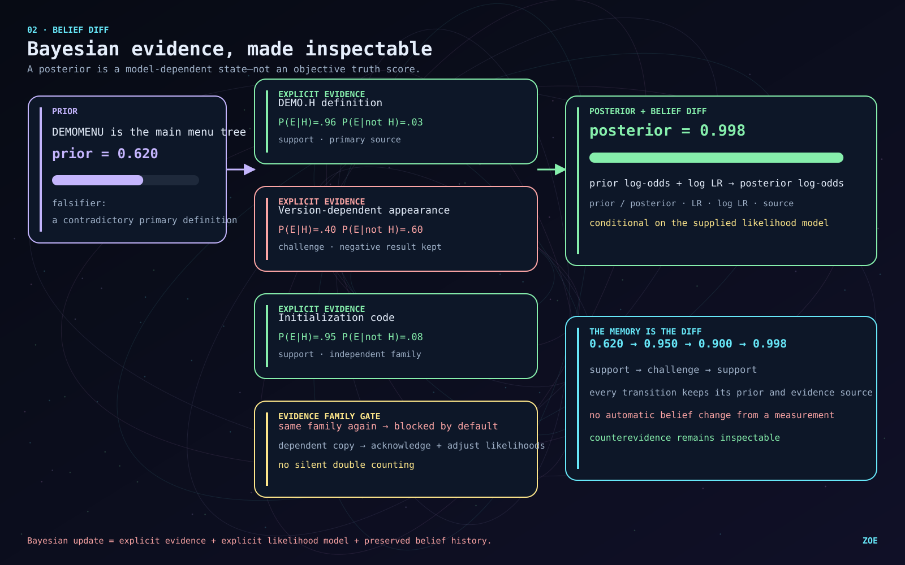
   [SVG](../assets/zoe-visuals/02-belief-diff.svg)

3. **Deterministic and stochastic chambers:** reproducible measurements and seeded forecasts have distinct identities and lifecycles.
   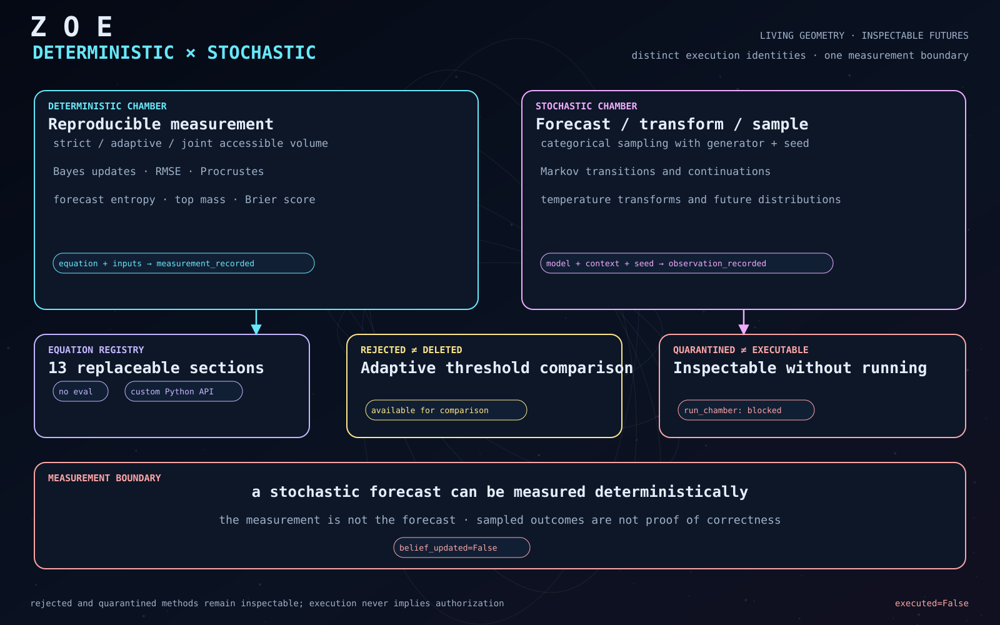
   [SVG](../assets/zoe-visuals/03-chambers.svg)

4. **Append-only memory:** sequence-linked hashes support replay and tamper detection without claiming authentication.
   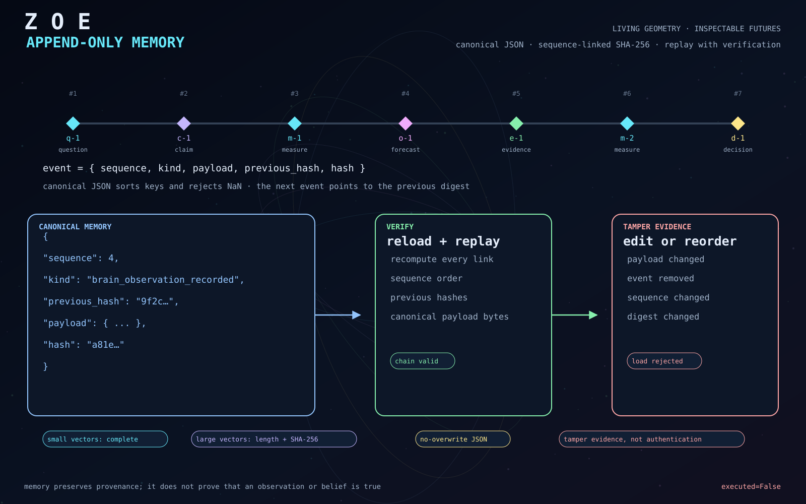
   [SVG](../assets/zoe-visuals/04-memory-chain.svg)

5. **Next useful test:** decision support ranks attention while human review controls execution.
   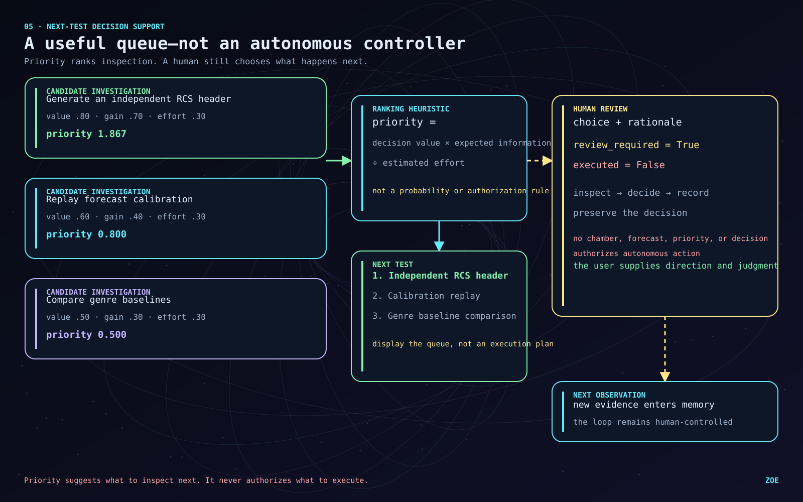
   [SVG](../assets/zoe-visuals/05-next-test.svg)

</details>

**Cerotto GEM:** a synthetic demonstration case with a successful guarded `query_timeline` action and the accessible-volume threshold sweep. No real incident data is shown.

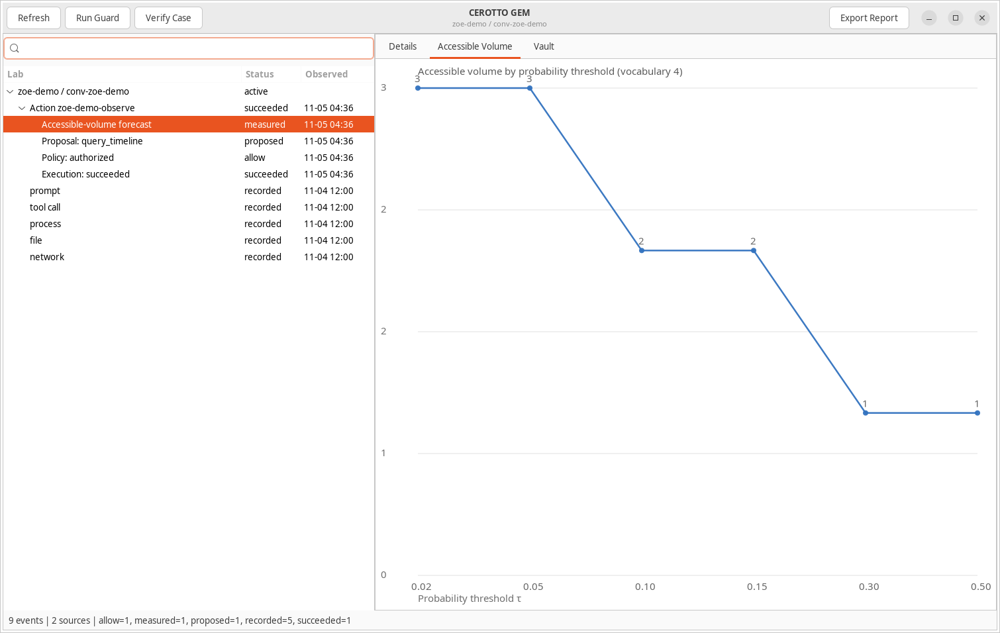

Zoe does not claim consciousness, universal future prediction, or automatic execution. Accessible volume measures forecast breadth, not correctness or human surprise. HOP remains a rejected baseline. Field-notebook posteriors are conditional on user-supplied priors and likelihoods, not objective truth scores. Chamber measurements and sampled outcomes never update claims automatically. Dependent evidence requires explicit acknowledgment and adjusted likelihoods. The memory hash chain provides tamper evidence, not authentication. Recommendations are experimental, `executed=False` remains the boundary between measurement and action, and the user decides what happens next.

## What the result does not establish

The experiment does not establish that a concentrated choice is a correct choice. It does not establish that a broad choice is a better choice. It does not demonstrate how later tokens will behave, and it does not turn a single-step measurement into a prediction of a complete response.

The measured models are also not interchangeable with Kimi, Claude, or Ablation’s semantic encoders. Those systems require their own probability distributions before equivalent measurements can be made. A distribution over command-text tokens is not automatically a distribution over complete structured actions.

The two Foundation-Sec-8B variants were not run. Each published repository contains approximately 16.06 GB of model weights, exceeding the available test-system storage for this experiment. They require a separate resource configuration; no result or limitation of those models is inferred here.

These limits do not weaken the measurement. They define its proper use. Accessible volume describes the shape of a particular forecast at a particular moment. Broader interpretations require separate evidence.

## Possible paths opened by the equation

The measurement also suggests directions for further work, without establishing them as completed findings.

**Prediction-aware review.** Repeated observations could provide early-warning metadata for an agent review system. An unusual change in the distribution might lead to additional review, a read-only restriction, or a request for human judgment. It would not establish why the change occurred. Any response would still need deterministic policy and signed evidence for later investigation.

**From tokens to structured actions.** A future experiment could examine distributions over complete permitted actions rather than command-text tokens. This might help a system prepare for several plausible next steps while preserving the same constraints on every action. It would not establish a user’s intent or make an action safe by virtue of being predicted.

**Authenticated, evolving evidence.** Prediction observations could become part of a signed evidence record whose keys rotate over time. Standard cryptographic key derivation and authenticated encryption would be required. A timestamp could determine when to rotate a key, but neither timing nor accessible volume should determine the key itself. The metric is not an entropy source or a source of cryptographic key material.

These are possible paths for investigation, not claims established by the present experiment.

## Conclusion

Accessible volume turns next-token predictability into a measurement. It counts the alternatives above a probability cutoff, showing whether a model’s immediate choice is concentrated on a few options or spread across many. The final output records a selection; accessible volume reveals the decision surface that preceded it.

The measured example shows the instrument working in practice. Four tokens exceed 0.02, two exceed 0.05, and one exceeds 0.15. That is the finding: a real investigation context produced a concentrated next-token decision surface, and the equation made it measurable.

The XLNet and sixteen additional comparisons show the same instrument operating across masked, query-stream, and causal prediction mechanisms. Their results also demonstrate that accessible volume and entropy can describe different aspects of the same distribution. These are individual, reproducible observations, not universal claims about model quality or safety.

The BioBERT experiment provides a direct practical result. The original fixed rule at $\tau=0.05$ distinguished incorrect and correct top predictions more effectively than the optimized adaptive equation on held-out biomedical documents. Although the adaptive rule improved validation measurements, the original equation achieved the stronger test AUROC and AUPRC. For this experiment, the simpler original equation was the better measurement of prediction uncertainty.

## Ablation + GEM as the working implementation

Ablation is the reverse-engineering framework. GEM (Graphics Environment Manager) is its graphical environment and shared investigation Lab. The public implementation is available at <https://github.com/Ablation-Tool/ablation>.

Ablation + GEM is itself a working demonstration of the chamber model. The AI Agent supplies probabilistic labor and proposals. Ablation + GEM supplies constrained execution, persistent state, verification, and replay. The human supplies direction and judgment. Investigation events, selected objects, evidence, and verification receipts form a unified memory architecture shared by the human and agent.

The implementation used for this experiment is revision [`d596bed3`](https://github.com/Ablation-Tool/ablation/commit/d596bed31ba5fe361efa1c6fdad6d86e3126ab63). At that revision, the main Ablation CI passed 2,803 tests with 93 skips, and native Linux, Windows, and macOS workflows passed. Those results demonstrate the implementation’s behavior. The accessible-volume experiment adds a separate measurement using actual session evidence produced by that implementation; it is not a claim that the metric was already part of the framework.

## Evidence manifest

The experiment used the public [`distilgpt2-ONNX`](https://huggingface.co/onnx-community/distilgpt2-ONNX) model and ONNX Runtime 1.31.1. Table 5 records the identities needed to verify the evidence independently.

| Item | Value |
|:---|:---|
| Model SHA-256 | `0f79f192f3137e9a90213f1b5d4a52b6d896b735f9cb82160e5de7cc6e539c41` |
| Tokenizer SHA-256 | `a6aa29bf8416d74ad795a73262b1aa3f985564ee338adbee7ffbc5861f78b6b8` |
| Model configuration SHA-256 | `dffb0253be590126da5dc43b75475f6f6ef4576439dec46e8ec83bf0408fcf83` |
| Probability values SHA-256 | `5f6313599e77e72947435e52b273054fabda1e97006d0636658350ac253ed638` |
| Input IDs SHA-256 | `970665aaaafdd2964012f3759b993e53dfe43e6d1793edc68a6b3896089fdbf8` |
| Entropy evidence SHA-256 | `fd551e583e54753744900d66acee85b99a6c07bdcef123f4fd92186a0cc8880d` |
| Original AFL paper SHA-256 | `dec64904f5954e29b44105ba6d41a97f38915ffbecf972554e4eda70d8abbebc` |
| AFL disclosure SHA-256 | `bfa75181d631aca4f8a95d0344819ec6c80ad3ac16ac9cd92ce3986e03055196` |
| XLNet-Base probability values SHA-256 | `c445b5ca7d6e46a01b071720c65f88db4411c69fcaf32a59b2a124c472b6d2ff` |
| XLNet-Large probability values SHA-256 | `a304a47ccd7d55bc3e5dbb2d616715e084446415529372789e2158da1ff72014` |
| XLNet input IDs SHA-256 (both models) | `2b84113e5c3b6006c097f5bea0966a972833d7a43de8e745c22a15c7b10c60ac` |
| Comparison manifest SHA-256 | `a278cbc15b5d9c6027678154c76a591fa5c95fb8c6e3e01ee26034d4a224e129` |
| Comparison summary SHA-256 | `c4e69b647d1f9ceb6f1c4c0d292ae1f2a3f7e6ee3bc4c778103f7ccd4d632611` |
| Verified comparison cases | 16 models, each with a complete raw probability vector |
| BioBERT case manifest SHA-256 | `cd743b76dc7e9ccc6d1c17dba546544271eac22dc557cb152c601c824e8922b6` |
| BioBERT baseline SHA-256 | `2f213c3e0338895c63e292ea2fe09ababa904cce22132eb99a8a2a8626de1b6d` |
| BioBERT optimization SHA-256 | `3c5829a65876959a904d417cffa7b953616be446b60b16fce768167d8e6fb42f` |
| BioBERT attachment list SHA-256 | `e612fe3b6b0cfdd80c1e02adfb1b233bdb5321eeff28a3fa0ded3d7313aafd20` |
| Verified BioBERT cases | 120 distributions; 60 development, 20 validation, 40 test |
| Context length | 963 tokens |
| Vocabulary size | 50,257 tokens |
| Probability sum | Approximately 1.0 within floating-point precision |

Evidence identity and scope.

The raw NPZ artifact contains the complete input-ID sequence and every probability value, not only the ten largest values. The JSON report contains the exact prompt, model metadata, threshold sweep, top tokens, and scope. The full entropy output and model configuration are reproduced below. The context-sweep artifact contains every controlled prompt variant and its raw probability vector.

## Reproduction procedure

The following procedure reproduces the numerical measurement in the tested CPU environment. It uses the public Ablation repository and the public ONNX model, with no API accounts.

1.  Clone <https://github.com/Ablation-Tool/ablation> and check out revision `d596bed31ba5fe361efa1c6fdad6d86e3126ab63`.

2.  Create an isolated Python 3.14 environment and install Ablation, GEM Lab, NumPy 2.3.5, ONNX Runtime 1.31.1, Tokenizers 0.23.3, and Hugging Face Hub 1.33.0.

3.  Obtain the measurement harness embedded in this PDF and place it in a writable working directory.

4.  Run `python scripts/ablation-gem-measure.py --project /path/to/ablation --output results`. The harness downloads and hash-checks the model, constructs real Lab evidence, runs inference, computes the sweep, and reloads the resulting probability vector for verification.

5.  Confirm the reference sweep $5,4,3,2,1,0$ and the actual sweep $4,2,2,1,1,1$ at thresholds $0.02,0.05,0.10,0.15,0.30,0.50$.

6.  Load the embedded probability vector and independently recompute each count using the strict comparison $P(a\mid h_T(S))>\tau$. Compare the raw-value and input-ID hashes with the manifest.

The numerical values and raw-value hashes are the reproducible evidence. Timing values and archive-container metadata may differ between runs.

For the XLNet extension, use `scripts/xlnet-accessible-volume.py`. Place the artifact writer, `scripts/ablation_gem_artifacts.py`, in the same working directory. Install NumPy, PyTorch 2.14.1, Transformers 5.18.0, and the tokenizer requirements. Run the script with `--model xlnet/xlnet-base-cased` and then with `--model xlnet/xlnet-large-cased`, using a different `--output` directory for each. The script performs a repeated prediction, checks all three target-token replacements, saves every probability and input ID, and independently recomputes the sweep. Compare the saved reports and raw arrays with the included evidence. Small floating-point differences may occur across runtimes; compare threshold counts and token ordering separately from exact probability hashes.

For the sixteen additional comparisons, use a separate Python 3.14 environment with NumPy 2.5.3, PyTorch 2.14.1, Transformers 4.56.2, Tokenizers 0.22.1, SentencePiece 0.2.2, and Hugging Face Hub 0.36.2. Keep the case manifest, runner, measurement harness, verifier, and artifact writer together. The runner uses the immutable revisions in the manifest, executes models sequentially, and removes only its own temporary per-model caches.

    python scripts/run-model-comparison.py --all \
      --output evidence/comparison \
      --cache-dir /path/to/temporary-cache

    python scripts/verify-model-comparison.py \
      --manifest evidence/comparison/model-comparison-cases.json \
      --evidence evidence/comparison

The optional cache directory must be writable and have enough space for the largest selected model. Use `--model` with an exact identifier from the manifest instead of `--all` to repeat one case. The second command verifies the included evidence without downloading model weights. A repeated BERT-Base case executed through this runner produced bit-identical probabilities, input IDs, and JSON output in the tested runtime. As with XLNet, exact raw-value equality across other runtimes is not assumed.

The BioBERT experiment uses the same Python and model-runtime versions as the sixteen additional comparisons. Keep the three experiment scripts, the independent verifier, the artifact writer, and the frozen `evidence/biobert-optimization` directory together. The included case and split manifests are the authoritative inputs; downloading new source documents is not required. Run:

    python scripts/biobert-accessible-volume.py
    python scripts/optimize-biobert.py
    python scripts/verify-biobert-optimization.py

The first command downloads the pinned BioBERT model and reproduces all 120 baseline distributions and reports. The second verifies the raw artifacts, selects adaptive parameters using development and validation cases only, and evaluates the frozen choice on the test cases. The third independently recomputes every AUROC and AUPRC value. Use `scripts/prepare-biobert-cases.py` only when constructing a new source-document manifest; it must complete before any model predictions are inspected.

## Controlled context evidence

The baseline was repeated before perturbing the context. It produced identical input IDs and probability values. Table 6 reports the controlled follow-up measurements.

| Variant                 | Tokens | 0.02 | 0.05 | 0.10 | 0.15 | 0.30 | 0.50 |
|:------------------------|-------:|-----:|-----:|-----:|-----:|-----:|-----:|
| Baseline                |    963 |    4 |    2 |    2 |    1 |    1 |    1 |
| Metadata only           |    522 |    4 |    2 |    2 |    2 |    1 |    0 |
| Abbreviated evidence    |    295 |    4 |    2 |    2 |    2 |    1 |    1 |
| No evidence             |    103 |    3 |    1 |    1 |    1 |    1 |    1 |
| Summary request         |    968 |    3 |    2 |    1 |    1 |    1 |    0 |
| Repeated short evidence |    487 |    3 |    2 |    2 |    1 |    1 |    1 |

Accessible volume across controlled context variants.

These differences are observations about specific model/context pairs. They do not establish a universal rule about which context increases or decreases breadth.

## Complete Ablation entropy evidence

    BinaryContext: true
      sha256     : 913a39cd38f35349...
      arch       : x86_64
      base_va    : 0x0
      func_starts: 20
      exports    : 2
      plt entries: 33
      strings    : 65
      call_edges : 136
      str_xrefs  : 89 pairs indexed
      named funcs: 0 (overlay)

      exports (first 2):
        0x257f  error
        0x26c8  error_at_line

      imports via PLT (first 20):
        0x2250  __vfprintf_chk
        0x2260  abort
        0x2270  __errno_location
        0x2280  strncmp
        0x2290  _exit
        0x22a0  __fpending
        0x22b0  fcntl
        0x22c0  textdomain
        0x22d0  fclose
        0x22e0  bindtextdomain
        0x22f0  dcgettext
        0x2300  __ctype_get_mb_cur_max
        0x2310  strlen
        0x2320  __stack_chk_fail
        0x2330  __overflow
        0x2340  strrchr
        0x2350  mbrtoc32
        0x2360  memcmp
        0x2370  fputs_unlocked
        0x2380  strcmp

    Entropy regions (26 found):
      0x00000000 - 0x00000400  (     1,024 B)  H=2.291  SPARSE
      0x00000400 - 0x00000700  (       768 B)  H=0.801  PADDING
      0x00000700 - 0x00000a00  (       768 B)  H=3.128  SPARSE
      0x00000a00 - 0x00000b00  (       256 B)  H=4.586  CODE
      0x00000b00 - 0x00000d00  (       512 B)  H=2.972  SPARSE
      0x00000d00 - 0x00002000  (     4,864 B)  H=0.271  PADDING
      0x00002000 - 0x00002400  (     1,024 B)  H=3.973  SPARSE
      0x00002400 - 0x00005300  (    12,032 B)  H=5.184  CODE
      0x00005300 - 0x00005400  (       256 B)  H=4.333  SPARSE
      0x00005400 - 0x00006000  (     3,072 B)  H=0.000  PADDING
      0x00006000 - 0x00006300  (       768 B)  H=4.865  CODE
      0x00006300 - 0x00006400  (       256 B)  H=3.591  SPARSE
      0x00006400 - 0x00006500  (       256 B)  H=4.503  CODE
      0x00006500 - 0x00006600  (       256 B)  H=4.477  SPARSE
      0x00006600 - 0x00006700  (       256 B)  H=4.980  CODE
      0x00006700 - 0x00006c00  (     1,280 B)  H=3.535  SPARSE
      0x00006c00 - 0x00006d00  (       256 B)  H=4.970  CODE
      0x00006d00 - 0x00006f00  (       512 B)  H=3.247  SPARSE
      0x00006f00 - 0x00007d00  (     3,584 B)  H=0.060  PADDING
      0x00007d00 - 0x00007e00  (       256 B)  H=1.535  SPARSE

## Model configuration

    {
      "_name_or_path": "distilbert/distilgpt2",
      "_num_labels": 1,
      "activation_function": "gelu_new",
      "architectures": [
        "GPT2LMHeadModel"
      ],
      "attn_pdrop": 0.1,
      "bos_token_id": 50256,
      "embd_pdrop": 0.1,
      "eos_token_id": 50256,
      "id2label": {
        "0": "LABEL_0"
      },
      "initializer_range": 0.02,
      "label2id": {
        "LABEL_0": 0
      },
      "layer_norm_epsilon": 1e-05,
      "model_type": "gpt2",
      "n_ctx": 1024,
      "n_embd": 768,
      "n_head": 12,
      "n_inner": null,
      "n_layer": 6,
      "n_positions": 1024,
      "reorder_and_upcast_attn": false,
      "resid_pdrop": 0.1,
      "scale_attn_by_inverse_layer_idx": false,
      "scale_attn_weights": true,
      "summary_activation": null,
      "summary_first_dropout": 0.1,
      "summary_proj_to_labels": true,
      "summary_type": "cls_index",
      "summary_use_proj": true,
      "task_specific_params": {
        "text-generation": {
          "do_sample": true,
          "max_length": 50
        }
      },
      "transformers_version": "4.43.4",
      "use_cache": true,
      "vocab_size": 50257
    }

## Embedded evidence

The complete evidence package is embedded in this PDF as 305 attachments. It includes the baseline experiment, XLNet Base and Large results, all sixteen additional model comparisons, and the focused BioBERT optimization study. Exact model inputs, complete probability vectors, JSON reports, immutable revisions, and raw-artifact hashes are preserved. The BioBERT package contains all 120 raw distributions and reports, frozen cases and document splits, source metadata and licenses, the complete parameter search, per-case scores, and an independent metric verifier. No external filesystem is needed to inspect the evidence; public model downloads are needed only to repeat inference.

## Screenshots

<details>
<summary>Earlier GEM integration research (superseded)</summary>

These historical screenshots record the stage before the working Zoe integration. The current implementation, native screenshots, and verification are documented in [What is Zoe?](#what-is-zoe).

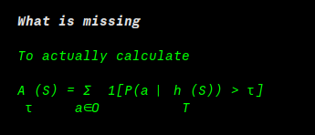

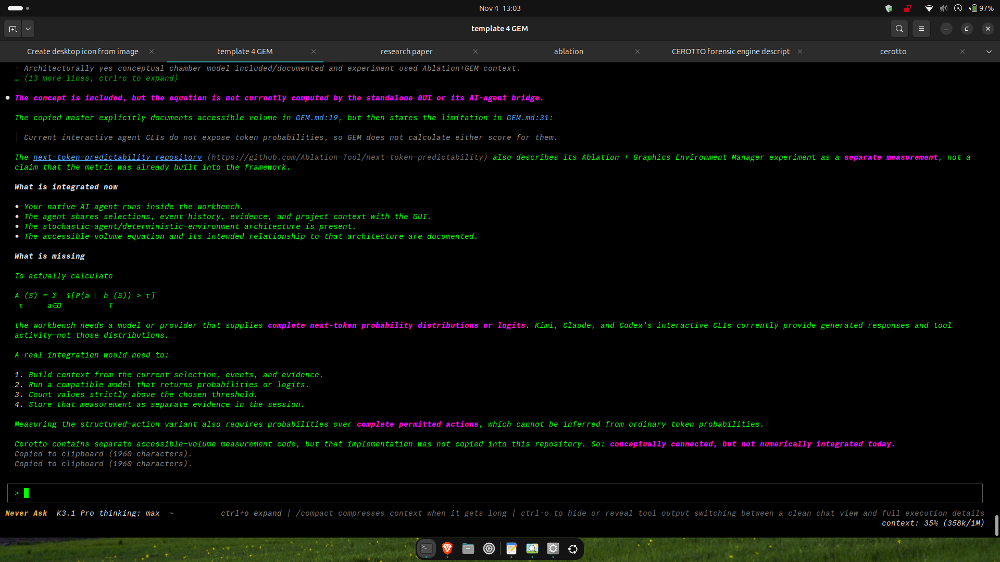

</details>

<details>
<summary>Research session screenshot</summary>

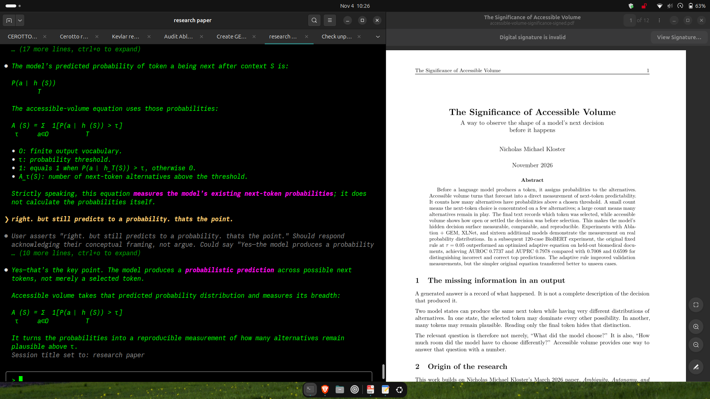

</details>

<details>
<summary>Original paper pages (12 images)</summary>

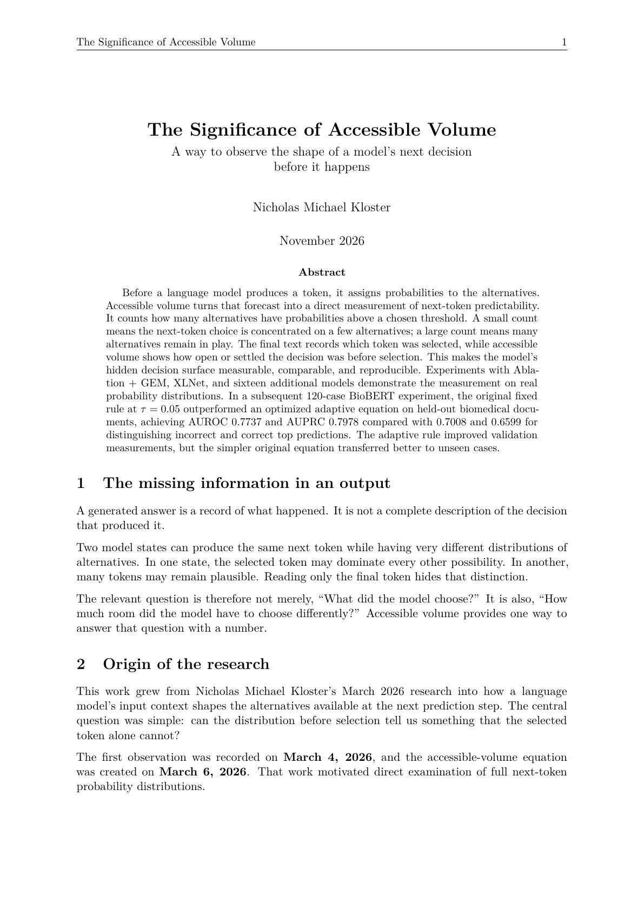

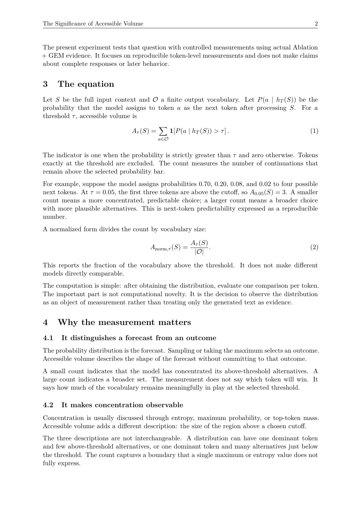

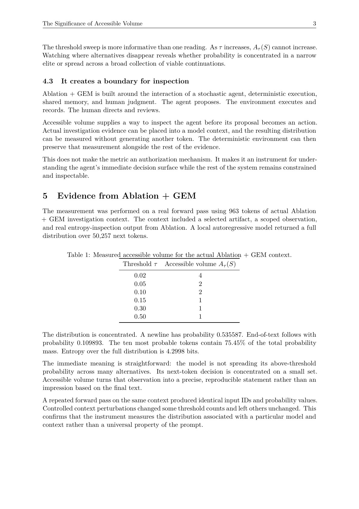

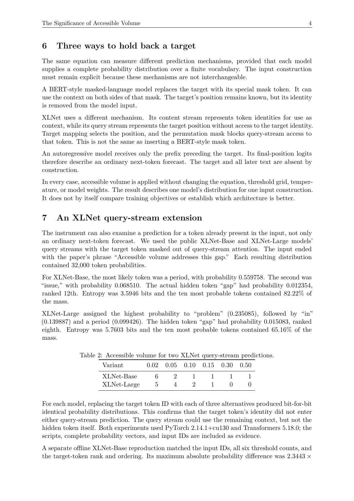

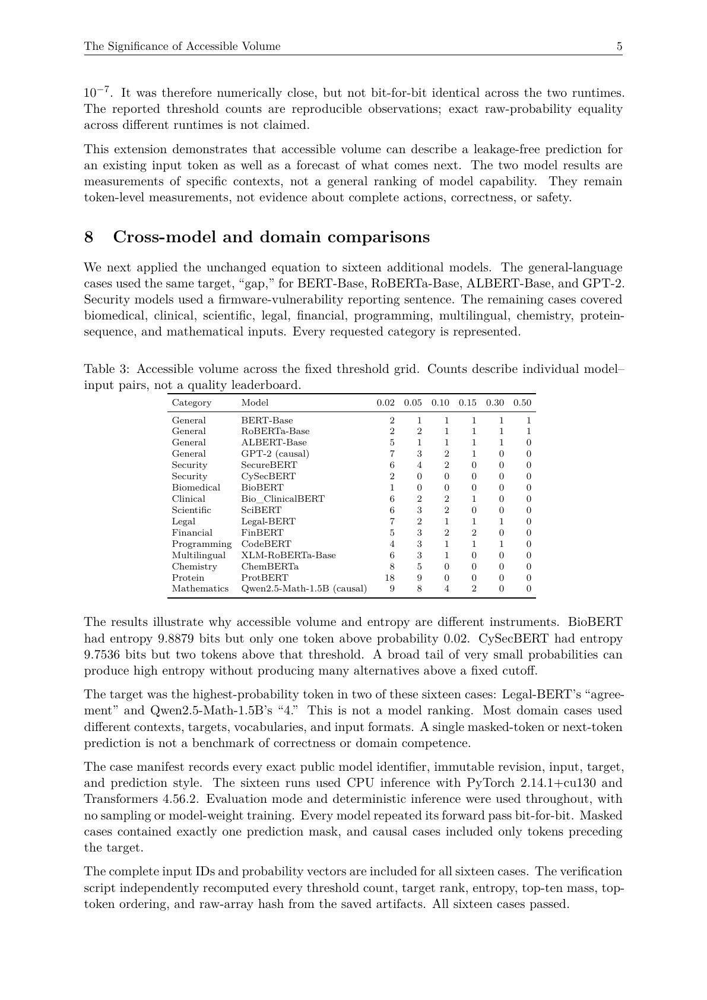

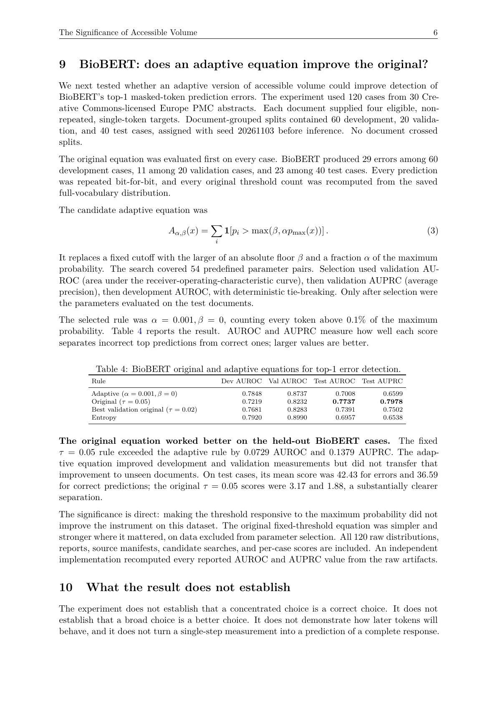

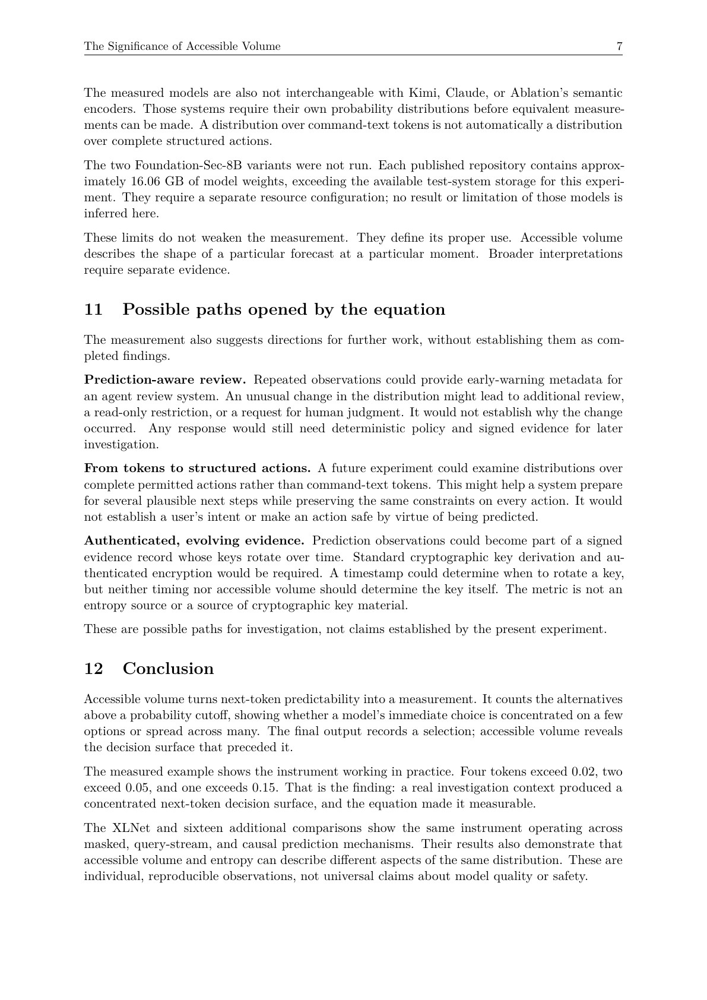

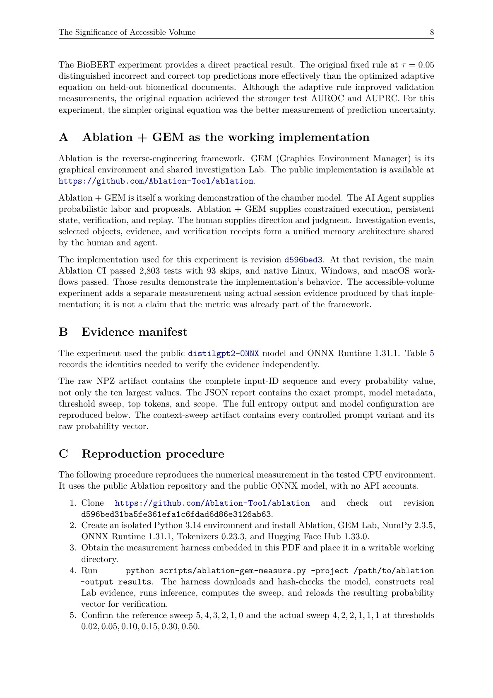

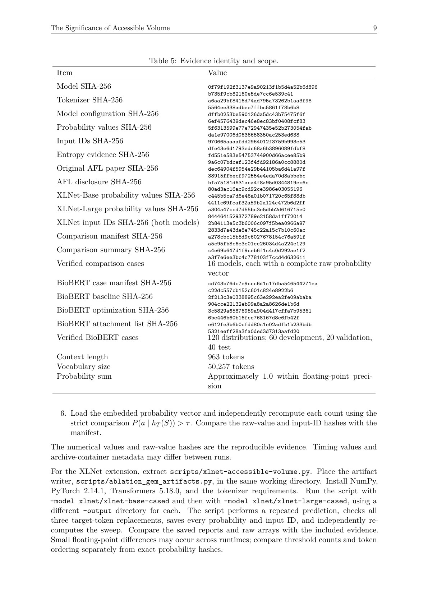

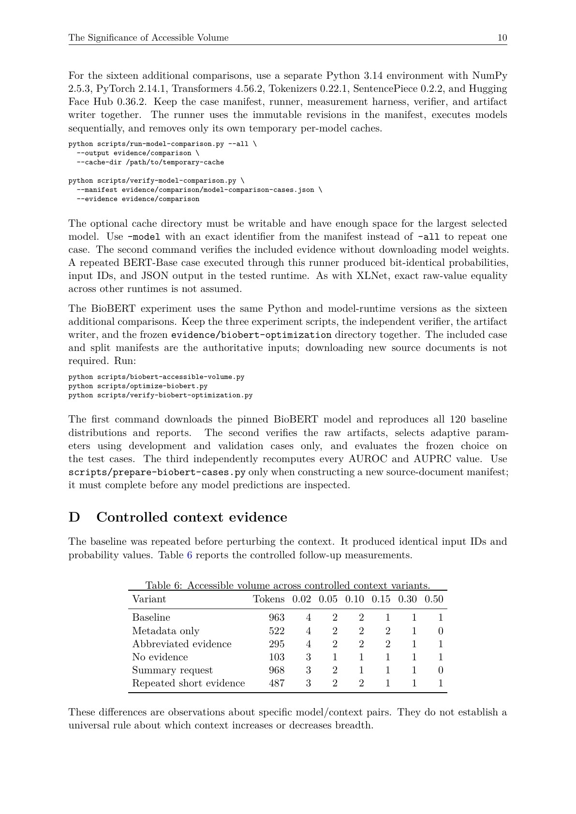

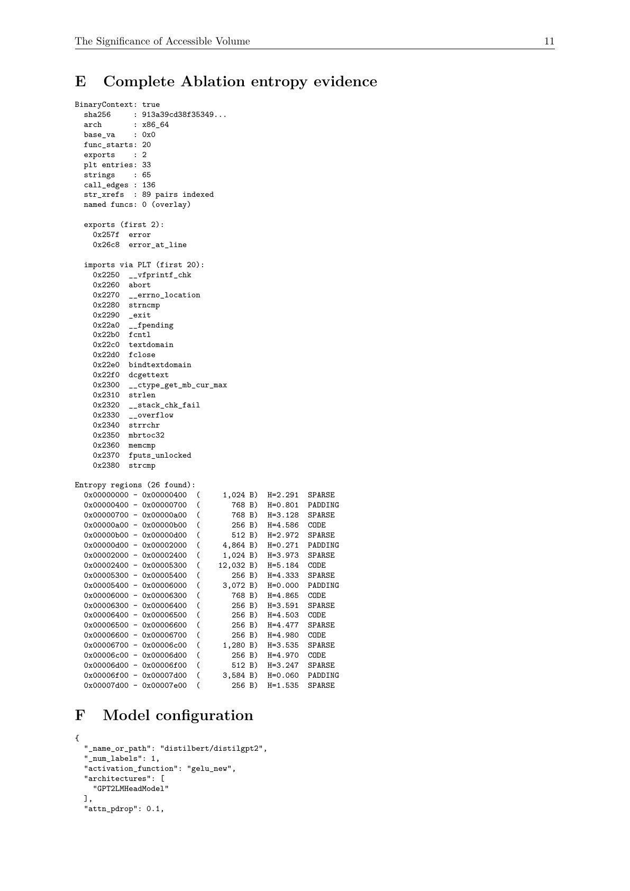

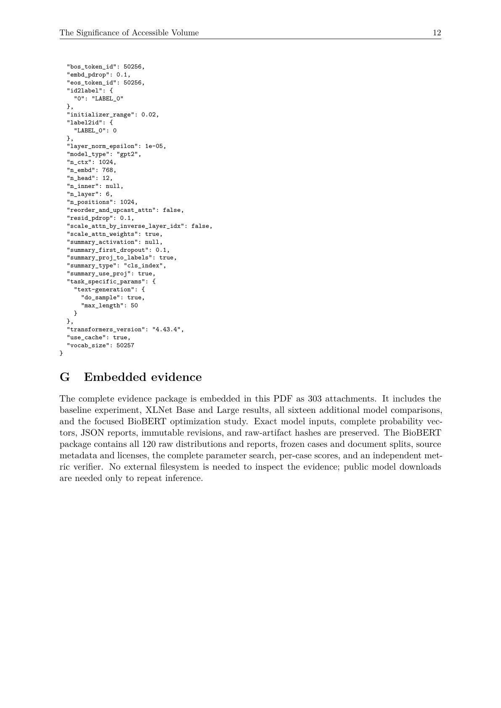

</details>
