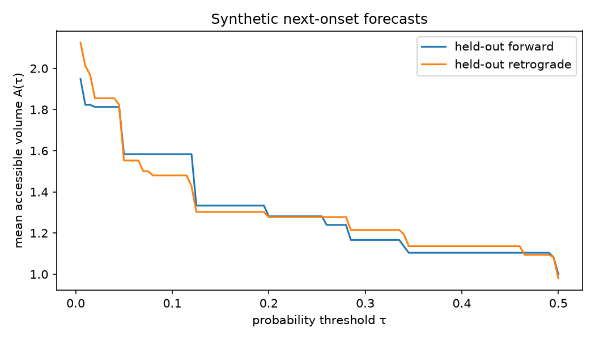

# HOP and next-onset experiment results

Both scripts were rerun locally and matched the reported outputs exactly. These are **exploratory results**, not evidence that all future tokens can be predicted.

## 1. HOP on real LLM hidden states

Source: [`scripts/hop-experiment.py`](../../scripts/hop-experiment.py)

The experiment evaluates 1,647 positions from the extracted music book, geometry book, and repeated code. It uses DistilGPT-2 hidden states and the model's learned unembedding. The recursive geometric predictor uses composed rotations rather than the earlier linear-looking update.

| Predictor | Top-1 | Top-5 |
|---|---:|---:|
| Model, 1 ahead | **46.6%** | **66.6%** |
| Linear velocity, 1 ahead | 41.3% | 60.0% |
| HOP, 1 ahead | 11.3% | 21.4% |
| Repeat token, 2 ahead | **5.4%** | 5.4% |
| Linear velocity, 2 ahead | 5.0% | **9.4%** |
| HOP, 2 ahead | 3.2% | 8.1% |

**Verdict:** HOP loses decisively. These transformer hidden-state trajectories do not locally behave like constant-curvature arcs often enough for this predictor to beat linear extrapolation. Low-entropy text improves predictions generally, but HOP still trails badly. No evidence here supports predicting all future tokens.

HOP remains useful as a **rejected baseline**: a sophisticated geometric or learned predictor should have to beat simple linear velocity before its added structure is credited.

## 2. Modular rhythm and accessible-volume experiment

Source: [`scripts/rhythm-accessible-volume.py`](../../scripts/rhythm-accessible-volume.py)

The synthetic data contains eight motifs, with 60 training and 20 held-out variations per motif, randomized tempo, and onset jitter.

Pipeline:

1. Normalize intervals by seconds per beat.
2. Center and unit-scale trailing onset vectors for one-dimensional Procrustes alignment.
3. Cluster aligned shapes into rhythmic contexts.
4. Train a smoothed categorical next-interval predictor.
5. Compute \(A_\tau=\sum_k\mathbf 1[p(k)>\tau]\).
6. Compare held-out forward and retrograde sequences.

| Condition | Top-1 | Log-loss | Mean \(A(\tau)\) | Sweep area |
|---|---:|---:|---:|---:|
| Forward | **84.4%** | **0.339** | 1.31 | 0.647 |
| Retrograde | 59.0% | 2.899 | 1.31 | 0.649 |

The retrograde predictor is often **confidently wrong**: mean maximum probability is nearly identical at 0.842 forward versus 0.839 retrograde, so accessible volume barely changes.

> **Accessible volume measures the breadth of plausible alternatives, not whether the forecast is right.**

A deterministic linear-extrapolation baseline achieved 37.0% forward and 32.8% retrograde. It correctly contributes no accessible-volume measurement because it supplies no alternative distribution.



## What we can do with this information

The best use is an **uncertainty diagnostic and control signal**, not a standalone predictor.

- **Predictability map:** plot per-onset probability, accessible volume, and eventual prediction error. Show accuracy and breadth together to reveal repetitive grooves, ambiguous transitions, and confidently wrong forecasts.
- **Model evaluation:** compare top-\(k\) accuracy and log-loss for correctness, accessible volume for breadth, calibration for confidence, and forward/retrograde tests for temporal sensitivity.
- **Composition control:** adjust sampling temperature or candidate selection until accessible volume reaches a chosen range. Low breadth can support stable grooves, medium breadth controlled variation, and high breadth exploratory transitions.
- **Baseline testing:** require new geometric or learned predictors to outperform linear velocity. Learned draft heads remain the promising route for multi-token generation; the handcrafted arc predictor is not competitive.

The tradeoff is that a narrow forecast can be confidently wrong, while a broad forecast may represent legitimate uncertainty. Accessible volume must be interpreted alongside calibration and observed outcomes.

## Strongest next experiment

Use real MIDI performances across several genres:

1. Train the categorical onset predictor on forward sequences.
2. Measure per-onset accessible volume and calibration.
3. Compare forward and retrograde sequences.
4. Collect human ratings of surprise at each onset.
5. Test whether accessible volume predicts human surprise better than raw probability or model entropy.

That would connect the mathematical measurement to something musically meaningful and potentially produce a useful composition tool.

## Reproduction

Run from the repository root:

```bash
python scripts/rhythm-accessible-volume.py
python scripts/hop-experiment.py
```

Requirements include NumPy, PyTorch, Transformers, scikit-learn, and Matplotlib. HOP downloads `distilbert/distilgpt2` and expects the extracted books under `FOLIO_OUTPUT`, defaulting to `~/Documents/folio_output/`. Those original corpus files are not present on this host, so its full inference was not rerun; the saved negative baseline remains the evidence. The rhythm experiment is fully synthetic and regenerates [`rhythm-accessible-volume.png`](./rhythm-accessible-volume.png).

## Real-MIDI follow-ups

- [Magenta Groove MIDI experiment](../rhythm-midi/README.md): backward training nearly matches forward performance, while direct reversal transfer is worse. The penalty is primarily a model-transfer effect, not proof that retrograde rhythms are inherently unpredictable.
- [Nightingale real-MIDI experiment](../rhythm-lab/README.md): jazz has the broadest forecasts, reversal has only small effects, and the categorical predictor beats persistence. A human-surprise listening workflow is included, but its correlation remains pending real ratings.
- [Native GEM Procrustes integration](https://github.com/Ablation-Tool/graphics-environment-manager/tree/main/examples/landmark-alignment): the geometric alignment step is connected to native Lab, VDI, replay, and scoped evidence.

All three confirm the central lesson: **accessible volume measures forecast breadth, not correctness**.
