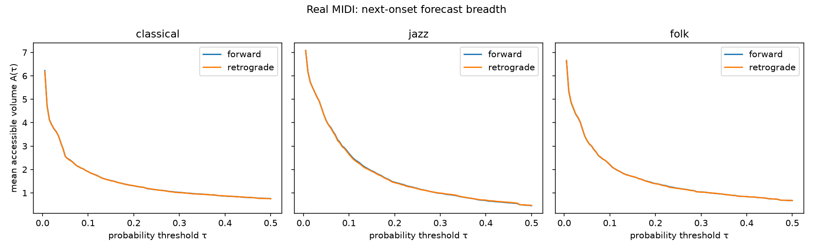
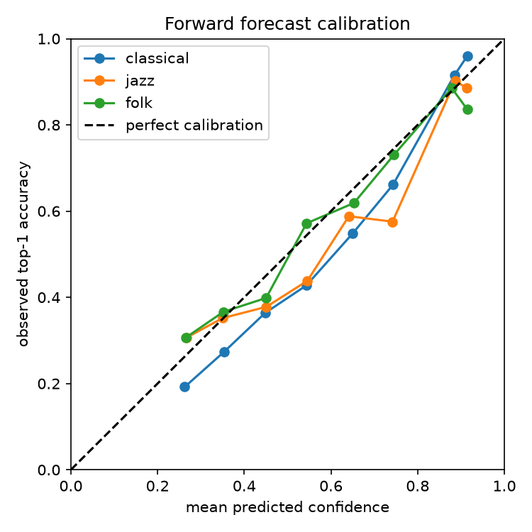

# Nightingale real-MIDI experiment and listening test

This experiment uses classical, jazz, and folk files from [nightingale-ai/midi-data](https://github.com/nightingale-ai/midi-data/). It evaluates the same categorical model in forward and retrograde conditions and includes an optional human-surprise listening test.

## Setup and results

There are **420 usable files**, split into 100 training and 40 test files per genre. Training used **139,839 onset positions**; evaluation used **57,113 predictions per direction**.

| Genre | Forward top-1 | Retrograde top-1 | Log-loss F / R | Accessible volume \(A(.1)\) F / R |
|---|---:|---:|---:|---:|
| Classical | **68.3%** | 67.9% | 0.976 / 1.024 | 1.91 / 1.91 |
| Jazz | 49.5% | 47.1% | 1.474 / 1.528 | 2.69 / 2.64 |
| Folk | 61.9% | 61.4% | 1.125 / 1.143 | 2.21 / 2.22 |

Main findings:

- **Jazz is least predictable and has the broadest forecasts.**
- Reversal produces only small changes; it does not inherently increase uncertainty or accessible volume.
- The categorical predictor beats persistence, especially in jazz (49.5% vs. 39.3%) and folk (61.9% vs. 54.8%).
- Expected calibration error is 0.031–0.064 across genres.
- Accessible volume remains a measure of **forecast breadth**, separate from correctness.

## Evidence and reproducibility

- [`results.json`](./results.json): complete forward and retrograde metrics, persistence, and linear baselines.
- [`parsed_onsets.pkl`](./parsed_onsets.pkl): derived onset cache used to reproduce the same context clusters and metrics without reparsing MIDI files.
- [`real_midi_accessible_volume.png`](./real_midi_accessible_volume.png): accessible-volume sweeps by genre.
- [`real_midi_calibration.png`](./real_midi_calibration.png): forward forecast calibration.
- [`stimuli.json`](./stimuli.json): 18 listening-test excerpts with measurements and labels.
- [`surprise_ratings.html`](./surprise_ratings.html): browser-based listening and JSON export interface.
- [`analyze_ratings.py`](./analyze_ratings.py): Spearman correlation analysis.
- [`../../scripts/real-midi-experiment.py`](../../scripts/real-midi-experiment.py): complete experiment implementation.





The experiment was rerun and produced the same headline metrics. `results.json` and `stimuli.json` were regenerated, then copied here unchanged.

Run from the repository root:

```bash
python scripts/real-midi-experiment.py
```

The script expects the Nightingale corpus under `../rhythm-lab/data/nightingale` relative to the repository root. Override that location with:

```bash
NIGHTINGALE_DATA=/path/to/nightingale python scripts/real-midi-experiment.py
```

Dependencies are NumPy, mido, scikit-learn, and Matplotlib. No raw MIDI files are redistributed.

## Human surprise correlation

The listening test contains **18 rhythms**. Play each and rate the final click from 1 (completely expected) to 5 (very surprising), then download `surprise_ratings.json`.

Analyze it with:

```bash
python evidence/rhythm-lab/analyze_ratings.py ~/Downloads/surprise_ratings.json
```

The analysis computes Spearman correlations between ratings and accessible volume, predictive entropy, negative log probability, and maximum probability, plus mean surprise by volume stratum.

**Human correlation is pending real ratings. No synthetic judgments were substituted.** The interface and complete rating/export/analysis flow passed browser testing, but a small listening sample would still not establish a perceptual effect.
