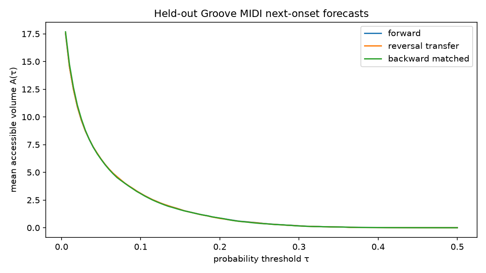
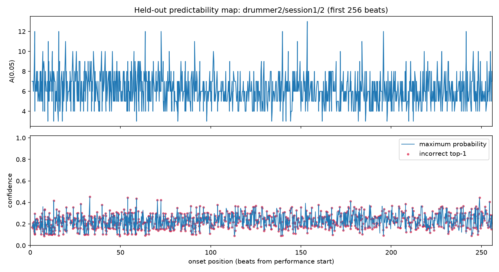

# Magenta Groove MIDI experiment

This is a real-MIDI follow-up to the synthetic rhythm experiment. The categorical model predicts **192 fine-grained interval categories** from expressive human drumming. Accessible volume measures forecast breadth, not correctness or human surprise.

## Setup

- **514 usable 4/4 performances** from the [Magenta Groove MIDI Dataset](https://magenta.tensorflow.org/datasets/groove), licensed CC BY 4.0.
- **396 training / 118 held-out performances**, split by recording session with zero train/test overlap.
- **218,033 training windows** and **121,392 test predictions per condition**.
- Expressive timing is preserved and quantized into 192 categories.
- Three conditions: forward evaluation, forward-model reversal transfer, and a matched model trained on reversed training performances.

## Results

| Condition | Top-1 | Top-5 | Log-loss | Mean \(A\) over sweep | Calibration error |
|---|---:|---:|---:|---:|---:|
| Forward | **17.33%** | **56.12%** | 3.194 | 1.886 | 0.060 |
| Reversal transfer | 16.01% | 52.99% | 3.333 | 1.885 | 0.072 |
| Backward matched | 17.06% | 55.52% | **3.183** | 1.886 | 0.060 |

The matched backward model nearly matches forward performance, while direct reversal transfer is worse. The reversal penalty is therefore primarily a **model-transfer effect**, not proof that retrograde rhythms are intrinsically unpredictable.

Accessible volume remains effectively unchanged: **forecast breadth did not identify forecast correctness**. The low top-1 accuracy is expected for fine-grained human timing across 192 categories.

## Evidence

- [`report.json`](./report.json): complete conditions, calibration bins, preprocessing, and artifact hashes.
- [`sources.json`](./sources.json): all 514 performances and their train/test session assignments.
- [`predictions.npz`](./predictions.npz): all three probability distributions, targets, sequence indices, and target positions (94 MB).
- [`accessible-volume.png`](./accessible-volume.png): threshold sweeps for all three conditions.
- [`predictability-map.png`](./predictability-map.png): accessible volume, confidence, and incorrect predictions over the first 256 beats of a held-out performance.





## Verification and reproduction

Every headline metric, threshold count, source-file hash, artifact hash, and the disjoint session split was independently recomputed from the saved arrays. Both complete runs produced identical numerical results.

Run from the repository root:

```bash
PYTHONPATH=/home/cowboy/security-tools/lib/python3.14/site-packages \
/home/cowboy/.rhythm-midi-venv/bin/python \
scripts/rhythm-midi-accessible-volume.py
```

The script defaults to `~/.cache/rhythm-midi/groove-v1.0.0/groove` and writes `~/rhythm_midi_results`. To use different locations:

```bash
/home/cowboy/.rhythm-midi-venv/bin/python scripts/rhythm-midi-accessible-volume.py \
  --dataset-root /path/to/groove \
  --output evidence/rhythm-midi
```

Dependencies are NumPy, mido, scikit-learn, and Matplotlib. The original MIDI dataset is not redistributed here; only predictions, metadata, and generated plots are included.
