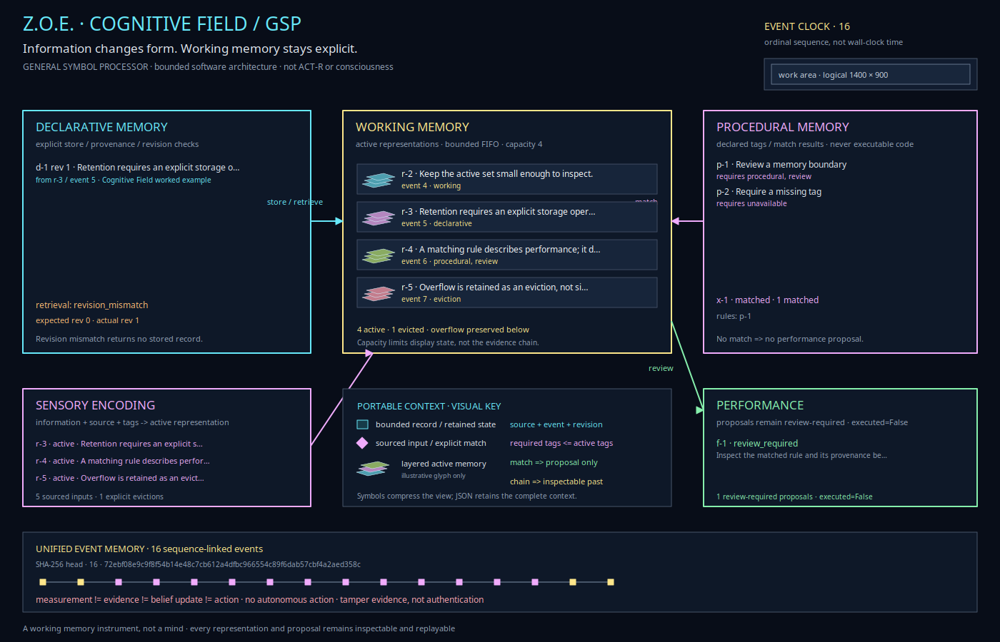

# Zoe · Cognitive Field

The Cognitive Field is a working, bounded memory instrument and software-level cognitive architecture. It coordinates memory, sensory-like encoding, rule matching, and review-gated performance rather than treating them as disconnected diagrams or claiming to model a human mind.

**GSP** means **General Symbol Processor** here: the explicit symbols are sourced text, tags, record IDs, revisions, and rule descriptions. Operations are deterministic transformations and subset matches over those symbols. GSP is not the historical General Problem Solver, a learned model, or a claim of unrestricted general intelligence.



## Open it

From the Zoe checkout:

```bash
PYTHONPATH=guiai-lab python -m guiai.gem zoe --module cognitive
```

In the existing Zoe window, choose **Zoe · Cognitive Field** in the module selector. The field starts empty. **Load worked Cognitive Field** supplies a deterministic example with an eviction, storage and retrieval, a revision mismatch, positive and negative rule matches, a review-required proposal, and an accessible-volume measurement.

For a new field, choose a working-memory capacity from 1 to 16 and select **Start empty with this capacity**. The default capacity is four. Changing capacity starts a new field rather than silently rewriting an existing event history.

Headless export does not need GTK:

```bash
PYTHONPATH=guiai-lab python -m guiai.gem cognitive --output cognitive-field.json
PYTHONPATH=guiai-lab python -m guiai.gem cognitive cognitive-field.json --output cognitive-field.svg
PYTHONPATH=guiai-lab python -m guiai.gem cognitive cognitive-field.json --output cognitive-field.png
PYTHONPATH=guiai-lab python -m guiai.gem cognitive cognitive-field.json --output cognitive-field.gem
PYTHONPATH=guiai-lab python -m guiai.gem zoe --module cognitive --output cognitive-field.svg
```

The first command saves the worked example. Supplying the saved JSON renders that exact memory. Cognitive Field JSON, SVG, PNG, and GEM VDI exports never overwrite an existing path. Scene and VDI checks run before every visual `gem cognitive` export.

## What each boundary does

**Information → sensory encoding → working memory.** Encoding requires text, a source, and 1–16 distinct tags. The new representation retains its event sequence and source. It enters a bounded FIFO working set; overflow is recorded as an explicit eviction. The sensory record and event remain available for inspection. This is a software data structure, not a biological sensory system.

**Working memory → declarative memory.** Storage is an explicit operation on an active representation. It retains the text, source, tags, source-representation ID, source-event sequence, and a revision number. An evicted representation cannot be stored as though it were still active. Retrieval requires the expected revision: a match returns the stored record; a mismatch is recorded and returns no stored record.

**Working memory ↔ procedural memory.** A rule has a name, required tags, and a human-readable performance description. Matching computes whether those tags are a subset of the union of active representation tags. It preserves positive and negative results. Rules contain no executable code, and matching does not invoke a callback.

**Working memory → performance.** A successful match can be used to prepare a proposal with a rationale. Every proposal has `review_required=True`, `belief_updated=False`, and `executed=False`. A no-match result cannot produce a proposal. Zoe does not execute a performance proposal.

**Forecast chambers.** The native controls measure the baseline `[0.70, 0.20, 0.08, 0.02]` distribution or draw a seeded categorical sample. Threshold changes affect strict accessible-volume measurement; seeds make the sample replayable. Measurements and samples do not change claims, create evidence, or authorize performance. The equation registry and epistemic firewall remain those of Zoe's Bayesian field notebook.

## Unified event memory

Cognitive operations share the field-notebook event chain:

- Every event has a sequence number, a kind, a payload, a previous-event hash, and a SHA-256 hash of canonical JSON.
- Loading reconstructs the full state from events and compares every sequence, previous hash, and event hash. Edits and reordering are rejected.
- Complete probability vectors of at most 64 values are stored; longer vectors become a length and SHA-256 digest.
- The capacity and limits are explicit: at most 16 active representations, 512 sensory records, 128 declarative records, 64 rules, 256 matches, 128 performance proposals, and 4,096 total events.
- JSON writes use exclusive creation. Visual exports use a temporary sibling file followed by an atomic hard-link creation, so they cannot overwrite a destination.

The event clock is a **local ordinal**, not a clock battery, a measurement of physical time, or a prediction of the future. The logical work area stays at 1400 × 900 scene coordinates; the physical viewport scales it without changing the memory or the exported geometry. This follows the supplied physical-screen/work-area reference without copying the source figure.

The **Z.O.E.** scene uses layered polygons for active memory and a compact visual key for records, sourced inputs, matching, review, and the event chain. These symbols make the view easier to scan; the accompanying text and JSON preserve the full context. The [supplied visual references and provenance](references/cognitive-field/PROVENANCE.md) remain separate from Zoe's generated scenes. The layered glyph is an illustrative projection, not a neural or anatomical model.

The hash chain supplies **tamper evidence, not authentication**. It has no secret key and cannot establish who created or edited a document.

## Worked example

The included example asks whether a measurement can change belief without an explicit evidence event. Its claim remains at the supplied prior; no evidence event is added. Five encoded observations produce one eviction at capacity four. One active representation is stored and retrieved once with the correct revision and once with a mismatch. Of two declared rules, only the rule whose tags are present matches. Its proposal awaits review. The final strict-threshold measurement uses Nicholas Michael Kloster's accessible-volume equation, credited to him alone, March 6, 2026.

Run the focused verification with:

```bash
PYTHONPATH=guiai-lab /usr/bin/python3 -m unittest stress.cognitive_stress -v
PYTHONPATH=guiai-lab guiai-lab/stress/nested_x11.sh \
  /usr/bin/python3 -m unittest stress.cognitive_stress -v
```

The suite covers capacity and eviction, provenance, revision mismatches, negative matches, review-required performance, deterministic and stochastic measurements, large-vector digests, round-trip replay, edited and reordered events, scene and VDI verification, all four export formats, no-overwrite behavior, and the native workflow.

## Scope

This is an original software architecture inspired by the supplied memory-flow composition. It is **not ACT-R or Spaun**, a trained neural network, a model of consciousness, or an autonomous agent. No CNN or regression forest is trained here. Anatomical artwork elsewhere in Zoe is illustrative or atlas-derived; this module uses no medical data. Accessible volume measures forecast breadth, not correctness. Human review remains the action boundary.

The [anatomical dialogue](images/zoe-cognitive-anatomy.png) pairs Zoe's existing organic brain artwork with the GSP memory pipeline. Inspired by the supplied [Cognitive architecture reference](https://en.wikiquote.org/wiki/Cognitive_architecture), it distinguishes sensory encoding, explicit transforms, decoding, and review. It does not map these operations to cortical regions or implement reward estimation, action selection, or motor output. The anatomical panel is illustrative; it is not a medical image or a model of Zoe's software.
