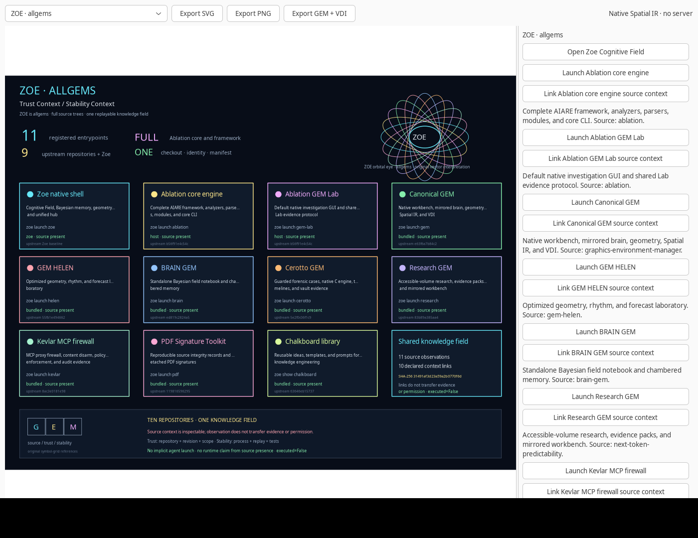

# ZOE · allgems: unified architecture and verification

ZOE is a single source repository containing the ten public Ablation-Tool organization repositories, including Zoe. The original repositories remain independent upstream projects. This repository does not require submodules or a runtime download to inspect their source.

When ZOE is embedded in Ablation, `ablation` and `gem-lab` resolve to the host checkout and are marked `host` in the component manifest. The other upstream source trees remain under `components/`. `ZOE_ABLATION_ROOT` overrides host detection when necessary. The imported ZOE revision and the excluded duplicate path are recorded in `ZOE-SOURCE.json`.

## Source and provenance

[`components.lock.json`](../../components.lock.json) records the upstream repository and full revision for every imported source tree. The snapshots were imported with `git subtree --squash`, preserving their content, licenses, notices, and source-revision metadata.

| Source | Revision | Included role |
|:---|:---|:---|
| Zoe | `f30c981` baseline | Native Cognitive Field, Bayesian memory, geometry, and unified hub |
| Ablation | `b56f91e4c54cfd996bceea63a38d8136dc1e689f` | Complete core engine, framework, native GEM Lab, tests, docs, and assets |
| graphics-environment-manager | `e63f6a7b84c2e8fffc0fcf01001986ae928f66b5` | Canonical native GEM and mathematical workbench |
| GEM HELEN | `55fb1e494662e9b69e964ac2f9df41724cffeb0c` | Optimized native geometry and forecast experiments |
| BRAIN GEM | `ed819c2824a55b019a532f4fa2cb440532030127` | Standalone Bayesian field notebook |
| Cerotto | `5e2f0c06f1c9b6f6fe7d2489175ce89e7abb6ec4` | Native C forensic engine and guarded GEM workbench |
| next-token-predictability | `83b89a385aa4e67fb0c1b60ba30a21efcc0e50f9` | Accessible-volume research and saved evidence |
| Kevlar | `8ac3e0181e98572d6c41f964385393aa441a5f2a` | MCP firewall and pure policy engine |
| PDF Signature Toolkit | `1198165962958c5132130f3854626ff39c333941` | Source integrity and PDF signature commands |
| Chalkboard | `63646eb15737d822316073ba1f2114c608571c72` | Ideas, templates, and prompts; content only |

Eleven launch or inspection endpoints span those ten repositories because Ablation supplies both its core CLI and native Lab. Chalkboard has an inspection endpoint, not a fictitious GUI command.

## The mesh

`guiai.gem.knowledge.KnowledgeField` is the shared event memory. It records:

- Source observations with component, repository, revision, source, and explicit scope.
- Stability context identifying component-specific processes, unverified runtime state, and canonical event replay.
- Declared links between observations and components.
- `belief_updated=False`, `executed=False`, `evidence_transfer=False`, and `permission_transfer=False` where applicable.

A source observation records **source registration only**. It does not prove runtime behavior, truth, trustworthiness, or permission to act. Declared links are inspectable relationships, not evidence or authorization transfer. The shared graph uses canonical JSON, sequence numbers, previous-event hashes, SHA-256, complete load-time verification, and no-overwrite saves. It provides tamper evidence, not authentication.

**Trust Context** means repository, revision, source, scope, and the relevant authorization boundary. **Stability Context** means isolated component processes, pinned source revisions, deterministic replay, and separately tested behavior. Neither phrase promises automatic trust, availability, correctness, or security.

## Native hub and CLI

Install the hub command from this checkout:

```bash
python -m pip install ./guiai-lab
zoe
```

The native selector is **ZOE · allgems**. It supports:

- Opening Zoe's Cognitive Field.
- Launching the Ablation core CLI, native Ablation Lab, canonical GEM, HELEN, BRAIN, Cerotto, research workbench, Kevlar, and PDF verification.
- Inspecting Chalkboard's content source without starting a process.
- Recording source-context observations and declared links.
- Exporting a component manifest or the knowledge graph.

The default native Ablation Lab command is `gem launch --no-agent`. Cerotto launches only after a case database, case ID, and conversation ID are supplied. No component starts merely because the hub or its scene was opened.

Equivalent command examples:

```bash
zoe list
zoe show chalkboard
zoe launch ablation -- --help
zoe launch gem-lab
zoe launch gem
zoe launch helen
zoe launch brain
zoe launch research
zoe launch kevlar -- --help
zoe launch pdf -- --help
zoe launch cerotto -- --db case.db --case incident-7 --conversation conv-7
zoe manifest --output gem-components.json
zoe knowledge --output gem-knowledge.json
```

Arguments after `--` are forwarded as an argument array without a shell. Component working directories and Python paths are explicit. The host's unrelated `PYTHONPATH` is not inherited. `ZOE_ROOT`, `ZOE_PYTHON`, and `ZOE_PYTHON_DEPENDENCIES` can select the checkout, interpreter, and additional dependency directories. Each component retains its own dependency manifest; the hub does not install every optional model, parser, or native tool.

## Verification

Unified integration and real headless command checks:

```bash
GEM_COMPONENT_TESTS=1 PYTHONPATH=guiai-lab \
  /usr/bin/python3 -m unittest stress.unified_stress -v

PYTHONPATH=guiai-lab guiai-lab/stress/nested_x11.sh \
  /usr/bin/python3 -m unittest stress.unified_stress -v
```

The suite checks all ten source trees, full Ablation engine presence, manifest revisions, trust/stability metadata, graph replay, edited and reordered event detection, no-overwrite saves, content-library inspection, command isolation, actual component CLI calls, native launch and source-link controls, and Spatial IR/VDI verification.

Component-specific verification uses each project's own commands. Cerotto's normal and sanitizer suites are required. Kevlar uses its full `pytest` suite. Canonical GEM and Zoe use their core and native X11 suites. Research uses the frozen evidence verifiers and the canonical 17-operation workbench check. PDF Signature Toolkit is exercised with a temporary synthetic LaTeX source record, not a real identity or production signature. Chalkboard is checked as content, including its documented template paths.

Measured results for this integration:

- Ablation core and ZOE host integration: **2805 passed, 93 skipped, 49 subtests passed**, including two host-mapping and real-launch tests.
- Ablation Lab: **69 core, 36 GTK, 1 real desktop-input, 30 native Tk, and 35 GEM tests passed**. The 40-tab churn test completed with bounded memory and all child processes reaped.
- Canonical GEM: **65 integration tests passed**, plus **30 tool-discovery checks in both core and native runs** and the **17-operation workbench check**.
- Cerotto: **65 normal and 65 sanitizer tests passed**. Kevlar: **149 tests passed**. BRAIN: **16 tests passed**, including native workflows.
- Research: **16 comparison cases** and **120 BioBERT cases verified**. PDF seal/verify and no-overwrite checks used a synthetic source record. Chalkboard template and prompt paths were checked.
- Unified integration: **8 headless and 8 native tests passed**, including real component commands, source graph replay, native controls, and VDI checks.
- Zoe regressions: **31 existing tests**, **36 cognitive/GEM/unified tests with two optional skips**, **29 core-stress tests**, and **21 native-stress tests passed**.
- Package: both wheel and source distribution built; the wheel installed into the isolated test runtime. The installed `zoe` entrypoint opened the native hub used for the screenshot below. The exported graph reloaded with 11 observations, 10 links, and 21 events. The actual VDI file passed `verify_vdi` in `vdi-verification.json`.

Host mapping resolves Ablation's core engine and native Lab to the host checkout, with `ZOE_ABLATION_ROOT` available for another layout. BRAIN uses the existing sibling `_callbacks` helper correctly. Ablation Lab reuses each button's themed pixbuf, updates its image only when that pixbuf changes, restores compact preferences synchronously, and lets the shutdown fallback reap an exited child even when the VTE callback has not run. No original test assertion was weakened.

`evidence/unified/verification.json` records these results and their scopes. `components.json` and `source-graph.json` contain the final source identity. `render-*.json`, `vdi-verification.json`, and `chalkboard.json` preserve the corresponding real exports in that directory. The full 35-test GEM suite passed in this embedded verification.

No single command is presented as proof that every optional backend, model, graphics driver, external VDI consumer, or production security boundary has been validated. Source presence and source registration do not imply runtime verification, trustworthiness, or authorization.

## Update discipline

Update one component at a time with its upstream URL and a reviewed revision, for example:

```bash
git subtree pull --prefix=components/ablation \
  https://github.com/Ablation-Tool/ablation.git main --squash
```

Do not bulk-update all components without reviewing their changes. Update `components.lock.json`, preserve local work, rerun the affected component and unified suites, and record new evidence. Never force-push over the upstream projects.

## Emblem and symbol references

`assets/branding/zoe-eye.png` is the primary ZOE emblem, generated from the user-supplied eye/orbital reference by `assets/branding/render_eye.py`. The earlier `orbital-emblem.png` remains the source of the orbital motif. The G, E, and M symbol-grid references are preserved under `assets/branding/references/` with their source filenames in `assets/branding/PROVENANCE.md`. Historical recognition for Gary Kildall and the original Digital Research contributors is recorded in `NOTICE`.



The screenshot shows the actual GTK hub and explicit component controls. Source presence is not runtime verification. Component processes, evidence, and authorization remain distinct even though their source and trust/stability context meet in one repository and knowledge graph.
